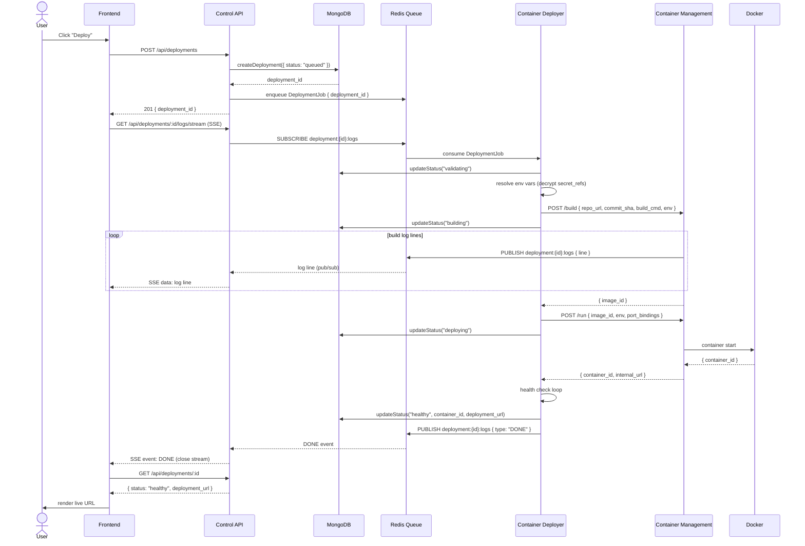
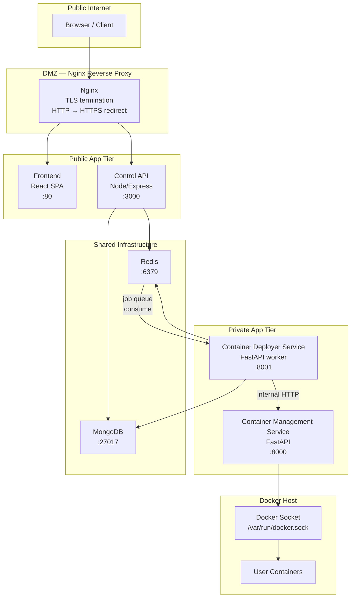

# ShipYard — System Architecture

> This document is the authoritative reference for how ShipYard's four services interact. Read this before any per-service LLD.

---

## System Overview

ShipYard is composed of four runtime services and two shared infrastructure components:

| Component | Runtime |
|---|---|
| **Control API** | Node.js / Express / TypeScript |
| **Container Management Service (CMS)** | Python / FastAPI |
| **Container Deployer Service (CDS)** | Python / FastAPI + Redis worker |
| **Frontend** | React / Vite / TypeScript (static SPA) |
| **MongoDB** | Shared data store (Control API owns writes) |
| **Redis** | Shared queue + pub/sub (CDS consumes, Control API produces) |

The Control API is the **single public-facing backend**. Neither CMS nor CDS are reachable from the internet — they only accept calls from CDS (for CMS) and from Redis (for CDS).

---

## Service Responsibilities

| Service | Language | Port | Responsibility |
|---|---|---|---|
| `control-api` | Node.js / Express / TypeScript | 3000 | GitHub OAuth, project/service/deployment CRUD, enqueues jobs to Redis, streams SSE logs to browser, webhook callbacks from CDS |
| `cms` | Python / FastAPI | 8000 | Thin wrapper over Docker SDK — builds images, runs/stops/inspects containers, tails logs. Exposes a REST API consumed **only** by CDS |
| `cds` | Python / FastAPI + Redis worker | 8001 | Consumes deployment jobs from Redis queue, drives the deployment state machine, calls CMS for Docker operations, writes status updates to MongoDB, publishes log lines to Redis pub/sub |
| `frontend` | React / Vite / TypeScript | 5173 (dev) | SPA — renders dashboard, service config forms, real-time log viewer (SSE). Talks **only** to `control-api` |

---

## Data Flow: Happy Path Deployment

The numbered steps below map 1-to-1 with the sequence diagram in the next section.

```
 1. User clicks "Deploy" on the Frontend.
 2. Frontend → POST /api/deployments  (Control API)
 3. Control API validates the request, resolves the service config from MongoDB.
 4. Control API creates a Deployment document in MongoDB with status = "queued".
 5. Control API enqueues a DeploymentJob onto the Redis queue (key: "deployments").
    └─ Uses transactional outbox pattern: DB write and queue publish are coupled.
 6. Control API responds 201 { deployment_id } to the Frontend.
 7. Frontend opens an SSE connection: GET /api/deployments/:id/logs/stream
 8. Control API subscribes to Redis pub/sub channel "deployment:{id}:logs".
 9. Container Deployer Service (CDS) picks up the job from the Redis queue.
10. CDS updates Deployment status → "validating" in MongoDB.
11. CDS resolves env vars via EncryptionService (decrypts secret_refs).
12. CDS calls CMS: POST /build  { repo_url, commit_sha, build_command, env }
13. CMS clones the repo, runs the build, produces a Docker image.
14. CMS streams build log lines to Redis pub/sub: "deployment:{id}:logs".
15. Control API's SSE handler relays those lines to the browser.
16. CDS updates Deployment status → "building".
17. On successful build, CMS returns { image_id } to CDS.
18. CDS calls CMS: POST /run  { image_id, env, port_bindings }
19. CMS starts the Docker container, returns { container_id, internal_url }.
20. CDS updates Deployment status → "deploying".
21. CDS performs a health check against the container's /health endpoint.
22. On healthy response, CDS updates Deployment:
      status → "healthy"
      container_id → <id>
      deployment_url → <internal_url>
      finished_at → now()
23. CDS publishes a final "DONE" event to Redis pub/sub.
24. Control API SSE handler sends the final event to the browser and closes the stream.
25. Frontend re-fetches deployment status and renders the live URL.
```

### SSE Stream Path (parallel to steps 14–24)

```
Redis pub/sub channel: "deployment:{id}:logs"
        │
        ▼
Control API  ──SSE──►  Browser (EventSource)
  (fan-out)            (renders log lines in real-time)
```

The Control API acts as a fan-out relay: it subscribes to the Redis channel once per open SSE connection and writes each message directly to the HTTP response stream.

---

## Architecture Decision Records

### ADR-1: Node.js for the Control API

| | |
|---|---|
| **Decision** | Use Node.js + Express + TypeScript for the Control API |
| **Why** | The Control API is primarily I/O-bound (DB reads/writes, queue publishes, SSE streaming). Node's event-loop excels at I/O concurrency. The team is already proficient with the MERN stack, reducing context switching. TypeScript provides type safety across both the API and the Mongoose schemas |
| **Trade-off** | CPU-intensive tasks (image building, log parsing at scale) must NOT run in the Control API process — they belong in CMS/CDS. If the team ever needs heavy compute in the API tier, a worker thread or a separate microservice is the escape hatch |

---

### ADR-2: FastAPI for Container Services

| | |
|---|---|
| **Decision** | Use Python + FastAPI for both CMS and CDS |
| **Why** | Docker's official SDK (`docker` PyPI package) is Python-native and best maintained in Python. FastAPI's async support (`asyncio`) maps well to the async nature of container operations (waiting for builds, health checks). Pydantic models give strong runtime type validation on the internal API boundary |
| **Trade-off** | Two language runtimes in the stack (Node + Python) increase operational surface area. Mitigated by Docker Compose / Kubernetes isolating each runtime in its own container |

---

### ADR-3: MongoDB for the Main Database

| | |
|---|---|
| **Decision** | Use MongoDB as the primary data store for all Control API entities |
| **Why** | The `service_config` field on a Service is a free-form JSON blob that varies per provider (Vercel config differs from a homelab Docker config). MongoDB's document model accommodates this without ALTER TABLE migrations. Deployment and log data is append-heavy and read by `deployment_id` — MongoDB handles this access pattern efficiently with a compound index |
| **Trade-off** | No multi-document ACID transactions by default (used sparingly via sessions for the outbox pattern). Relations between collections (User → Project → Service → Deployment) must be enforced at the application layer |

---

### ADR-4: Redis for the Job Queue

| | |
|---|---|
| **Decision** | Use Redis as the deployment job queue, compatible with the BullMQ protocol |
| **Why** | Redis is already in the stack for pub/sub (log streaming). Reusing it for the queue avoids adding a dedicated message broker (RabbitMQ, SQS). BullMQ provides built-in retries, dead-letter queues, delayed jobs, and job progress — features that would otherwise be hand-rolled |
| **Trade-off** | Redis is in-memory; if it restarts without AOF persistence, unprocessed jobs are lost. Mitigation: enable Redis AOF persistence and use BullMQ's `removeOnComplete: false` until a job is acknowledged |

---

### ADR-5: SSE for Live Log Streaming

| | |
|---|---|
| **Decision** | Use Server-Sent Events (SSE) over a plain HTTP endpoint for real-time log delivery to the browser |
| **Why** | Log streaming is strictly unidirectional: server → browser. SSE is the standard mechanism for this pattern. It works over HTTP/1.1 (no upgrade handshake), is natively supported by the browser's `EventSource` API, and automatically reconnects on drop. WebSockets would add bidirectional complexity with no benefit for this use case |
| **Trade-off** | SSE connections are long-lived HTTP connections and count against the server's connection limits. For very high concurrent user counts, a dedicated SSE fan-out service (or using Redis pub/sub directly from the browser via an intermediary) would be needed. Acceptable at current scale |

---

### ADR-6: Transactional Outbox Pattern

| | |
|---|---|
| **Decision** | Write the Deployment document to MongoDB and enqueue the Redis job as an atomic unit using the outbox pattern |
| **Why** | Without this, a crash between `await db.save()` and `await queue.add()` leaves a Deployment stuck in `queued` status with no corresponding job — the deployment is silently lost. The outbox pattern writes the job payload as a sub-document on the Deployment record first, then a background relay publishes it to Redis and marks the outbox entry as `published`. If the relay crashes, it replays on restart |
| **Trade-off** | Adds a small relay process (or a change-stream listener on MongoDB). Complexity worth the correctness guarantee |

---

### ADR-7: Provider Adapter Pattern

| | |
|---|---|
| **Decision** | All provider integrations (Vercel, Neon, Atlas, Homelab/Docker) implement a common `IProviderAdapter` TypeScript interface |
| **Why** | Deployment routes and service-layer code should not contain `if provider === "vercel"` branches. The adapter pattern isolates provider-specific logic behind a stable interface. Adding a new provider means adding a new adapter class — zero changes to existing routes |
| **Trade-off** | The interface must be designed conservatively to accommodate all provider capabilities. Features unique to one provider (e.g., Vercel Edge Functions) must be surfaced through the `service_config` JSON field rather than first-class interface methods |

---

## Sequence Diagram: Full Deployment Flow



---

## Network Boundary Diagram



> [!IMPORTANT]
> **CMS and CDS are never exposed to the public internet.** There is no Nginx route to `:8000` or `:8001`. They communicate only via Redis (CDS ← queue) and direct internal HTTP (CDS → CMS). This is enforced at the Docker network level: both services are on a private bridge network with no published ports.

> [!CAUTION]
> The Docker socket (`/var/run/docker.sock`) grants root-equivalent access to the host. CMS is the **only** service mounted with this socket. It is the highest-privilege process in the system and must be deployed with a read-only filesystem (except for the socket mount) and a non-root user inside the container where possible.
