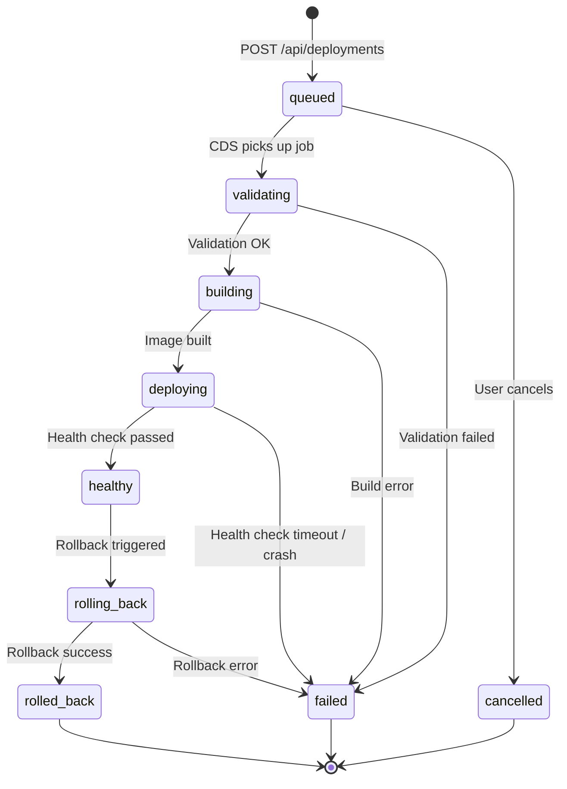

# ShipYard — Database Schema LLD

> **Service:** `control-api` (Node.js / Express / TypeScript / Mongoose)
> **Database:** MongoDB (single cluster, multiple collections)

All Mongoose schemas are defined in `control-api/src/models/`. Every schema uses `{ timestamps: true }` unless `created_at` / `updated_at` are managed manually for semantic precision.

---

## Table of Contents

1. [Users](#1-users)
2. [Projects](#2-projects)
3. [Services](#3-services)
4. [Deployments](#4-deployments)
5. [EnvironmentVars](#5-environmentvars)
6. [Domains](#6-domains)
7. [DeploymentLogs](#7-deploymentlogs)
8. [DeploymentEvents](#8-deploymentevents)
9. [ProviderConnections](#9-providerconnections)
10. [Deployment State Machine](#10-deployment-state-machine)

---

## 1. Users

### TypeScript Interface

```typescript
// control-api/src/models/User.ts

export interface IGithubData {
  github_id: number;        // GitHub's numeric user ID
  username: string;         // GitHub login handle
  avatar_url: string;
  email: string | null;     // GitHub email may be private
  access_token_ref: string; // secret_ref — NOT the raw token
}

export interface IUser {
  _id: Types.ObjectId;
  username: string;             // mirrors GitHub username at time of signup
  user_github: IGithubData;
  no_of_deployments: number;    // denormalised counter — incremented on each deploy
  created_at: Date;
  updated_at: Date;
}
```

### Mongoose Schema

```typescript
// control-api/src/models/User.ts

import { Schema, model, Types } from 'mongoose';

const GithubDataSchema = new Schema<IGithubData>({
  github_id:        { type: Number,  required: true, unique: true },
  username:         { type: String,  required: true },
  avatar_url:       { type: String,  required: true },
  email:            { type: String,  default: null },
  access_token_ref: { type: String,  required: true }, // e.g. "enc:v1:<ciphertext>"
}, { _id: false });

const UserSchema = new Schema<IUser>({
  username:           { type: String, required: true },
  user_github:        { type: GithubDataSchema, required: true },
  no_of_deployments:  { type: Number, default: 0 },
}, { timestamps: { createdAt: 'created_at', updatedAt: 'updated_at' } });

export const User = model<IUser>('User', UserSchema);
```

### Indexes

| Field | Type | Why |
|---|---|---|
| `user_github.github_id` | Unique | Primary lookup during OAuth callback — must be fast and collision-free |
| `username` | Regular | Dashboard search / slug resolution |

### Relationships

- One User → many Projects (via `project.user_id`)
- One User → many ProviderConnections (via `provider_connection.user_id`)

### Design Rationale

Users are simple entities with minimal relational complexity. MongoDB is adequate. The `access_token_ref` field deliberately holds a **reference** (encrypted blob prefix + ciphertext) rather than a plaintext GitHub OAuth token — see [EnvironmentVars §5](#5-environmentvars) and `08-secrets.md` for the full secret_ref pattern.

`no_of_deployments` is a denormalised counter. It is incremented atomically using `$inc` on each successful deployment rather than counted with an aggregation, keeping dashboard queries O(1).

---

## 2. Projects

### TypeScript Interface

```typescript
// control-api/src/models/Project.ts

export interface IProject {
  _id: Types.ObjectId;
  user_id: Types.ObjectId;   // ref: User
  project_name: string;
  github_url: string;        // e.g. "https://github.com/org/repo"
  created_at: Date;
  updated_at: Date;
}
```

### Mongoose Schema

```typescript
// control-api/src/models/Project.ts

import { Schema, model, Types } from 'mongoose';

const ProjectSchema = new Schema<IProject>({
  user_id:      { type: Schema.Types.ObjectId, ref: 'User', required: true },
  project_name: { type: String, required: true },
  github_url:   { type: String, required: true },
}, { timestamps: { createdAt: 'created_at', updatedAt: 'updated_at' } });

export const Project = model<IProject>('Project', ProjectSchema);
```

### Indexes

| Field(s) | Type | Why |
|---|---|---|
| `user_id` | Regular | Most queries are scoped to a user — list all projects for a user |
| `user_id + project_name` | Unique compound | Prevent duplicate project names per user |

### Relationships

- Many Projects → one User
- One Project → many Services (via `service.project_id`)

### Design Rationale

Projects are thin grouping entities. They hold no build/deploy logic themselves — that lives in Services. Keeping Projects separate lets users group multiple services (frontend + backend + database) under one project umbrella, mirroring the Railway/Render model.

---

## 3. Services

### TypeScript Interface

```typescript
// control-api/src/models/Service.ts

export type ServiceType = 'backend' | 'frontend' | 'database';

export interface IService {
  _id: Types.ObjectId;
  project_id: Types.ObjectId;              // ref: Project
  provider_connection_id: Types.ObjectId;  // ref: ProviderConnection
  service_name: string;
  service_type: ServiceType;
  repository: string;    // e.g. "org/repo" (short form)
  branch: string;        // e.g. "main"
  root_directory: string; // relative path, defaults to "/"
  build_command: string;  // e.g. "npm run build"
  pre_deploy_command?: string; // e.g. "npx prisma migrate deploy"
  start_command: string;  // e.g. "node dist/index.js"
  service_config: Record<string, unknown>; // provider-specific JSON blob
  created_at: Date;
  updated_at: Date;
}
```

### Mongoose Schema

```typescript
// control-api/src/models/Service.ts

import { Schema, model, Types } from 'mongoose';

const ServiceSchema = new Schema<IService>({
  project_id: {
    type: Schema.Types.ObjectId, ref: 'Project', required: true
  },
  provider_connection_id: {
    type: Schema.Types.ObjectId, ref: 'ProviderConnection', required: true
  },
  service_name:        { type: String, required: true },
  service_type:        { type: String, enum: ['backend', 'frontend', 'database'], required: true },
  repository:          { type: String, required: true },
  branch:              { type: String, required: true, default: 'main' },
  root_directory:      { type: String, default: '/' },
  build_command:       { type: String, required: true },
  pre_deploy_command:  { type: String },
  start_command:       { type: String, required: true },
  service_config:      { type: Schema.Types.Mixed, default: {} },
}, { timestamps: { createdAt: 'created_at', updatedAt: 'updated_at' } });

export const Service = model<IService>('Service', ServiceSchema);
```

### Indexes

| Field(s) | Type | Why |
|---|---|---|
| `project_id` | Regular | Load all services for a project dashboard |
| `project_id + service_name` | Unique compound | Prevent duplicate service names within a project |

### Relationships

- Many Services → one Project
- One Service → many Deployments
- One Service → many EnvironmentVars
- One Service → many Domains

### Design Rationale

`service_config` is the key reason MongoDB is the right fit here. For a homelab Docker deployment, it might hold `{ "memory_limit": "512m", "cpu_shares": 512 }`. For a Vercel deployment, it might hold `{ "framework": "nextjs", "regions": ["iad1"] }`. This heterogeneity would require either a wide nullable table in SQL or a JSONB column — MongoDB's document model handles it natively and legibly.

The `pre_deploy_command` (e.g., DB migrations) is a first-class field rather than a convention in `build_command` so that CDS can execute it as a distinct phase in the state machine, with its own success/failure logging.

---

## 4. Deployments

### TypeScript Interface

```typescript
// control-api/src/models/Deployment.ts

export type DeploymentStatus =
  | 'queued'
  | 'validating'
  | 'building'
  | 'deploying'
  | 'healthy'
  | 'failed'
  | 'cancelled'
  | 'rolling_back'
  | 'rolled_back';

export interface IConfigSnapshot {
  build_command: string;
  start_command: string;
  pre_deploy_command?: string;
  root_directory: string;
  branch: string;
  service_config: Record<string, unknown>;
  // Snapshot is taken at trigger time so re-deploys are reproducible
}

export interface IDeployment {
  _id: Types.ObjectId;
  service_id: Types.ObjectId;  // ref: Service
  commit_sha: string;
  branch: string;
  status: DeploymentStatus;
  config_snapshot: IConfigSnapshot; // frozen copy of Service config at trigger time
  image_id?: string;           // Docker image ID after successful build
  container_id?: string;       // Docker container ID after successful run
  deployment_url?: string;     // live URL once healthy
  created_at: Date;
  started_at?: Date;           // when CDS picked up the job
  finished_at?: Date;          // terminal state timestamp
  __v: number;                 // Mongoose version key — used for optimistic concurrency
}
```

### Mongoose Schema

```typescript
// control-api/src/models/Deployment.ts

import { Schema, model, Types } from 'mongoose';

const ConfigSnapshotSchema = new Schema({
  build_command:      { type: String, required: true },
  start_command:      { type: String, required: true },
  pre_deploy_command: { type: String },
  root_directory:     { type: String, required: true },
  branch:             { type: String, required: true },
  service_config:     { type: Schema.Types.Mixed, default: {} },
}, { _id: false });

const DeploymentSchema = new Schema<IDeployment>({
  service_id:      { type: Schema.Types.ObjectId, ref: 'Service', required: true },
  commit_sha:      { type: String, required: true },
  branch:          { type: String, required: true },
  status:          {
    type: String,
    enum: ['queued','validating','building','deploying','healthy','failed','cancelled','rolling_back','rolled_back'],
    required: true,
    default: 'queued',
  },
  config_snapshot: { type: ConfigSnapshotSchema, required: true },
  image_id:        { type: String },
  container_id:    { type: String },
  deployment_url:  { type: String },
  started_at:      { type: Date },
  finished_at:     { type: Date },
}, {
  timestamps: { createdAt: 'created_at', updatedAt: false },
  optimisticConcurrency: true, // Mongoose enables __v checking on save()
});

export const Deployment = model<IDeployment>('Deployment', DeploymentSchema);
```

### Indexes

| Field(s) | Type | Why |
|---|---|---|
| `service_id` | Regular | Load deployment history for a service |
| `service_id + created_at DESC` | Compound | Efficiently fetch latest deployment per service |
| `status` | Regular | Admin queries: "all failed deployments", rollback candidates |

### Relationships

- Many Deployments → one Service
- One Deployment → many DeploymentLogs
- One Deployment → many DeploymentEvents

### Design Rationale

**`config_snapshot`** is critical for reproducibility and auditing. When a user changes `build_command` on a Service, past deployments should still reflect the config that was actually used. The snapshot is taken at the moment of `POST /api/deployments` and never mutated.

**`image_id` and `container_id`** are populated progressively as the deployment advances — they are `undefined` until the respective Docker operation completes. This is intentional: the document is a living record of deployment progress, not a pre-declared contract.

**`started_at` / `finished_at`** are separate from `created_at` to enable accurate build-time measurement (`finished_at - started_at`) independent of queue wait time (`started_at - created_at`).

---

## 5. EnvironmentVars

### TypeScript Interface

```typescript
// control-api/src/models/EnvironmentVar.ts

export interface IEnvironmentVar {
  _id: Types.ObjectId;
  service_id: Types.ObjectId;  // ref: Service
  key: string;                 // e.g. "DATABASE_URL"
  secret_ref: string;          // e.g. "enc:v1:<base64-ciphertext>" — NOT the plaintext value
  sensitive: boolean;          // if true, value is never echoed back in API responses
  updated_at: Date;
}
```

### Mongoose Schema

```typescript
// control-api/src/models/EnvironmentVar.ts

import { Schema, model, Types } from 'mongoose';

const EnvironmentVarSchema = new Schema<IEnvironmentVar>({
  service_id:  { type: Schema.Types.ObjectId, ref: 'Service', required: true },
  key:         { type: String, required: true },
  secret_ref:  { type: String, required: true },
  sensitive:   { type: Boolean, default: true },
}, {
  timestamps: { createdAt: false, updatedAt: 'updated_at' },
});

export const EnvironmentVar = model<IEnvironmentVar>('EnvironmentVar', EnvironmentVarSchema);
```

### Indexes

| Field(s) | Type | Why |
|---|---|---|
| `service_id` | Regular | Load all env vars for a service before a deployment |
| `service_id + key` | Unique compound | One value per key per service |

### The `secret_ref` Pattern

> [!IMPORTANT]
> **Plaintext secret values are never stored in MongoDB.** The `secret_ref` field is a reference string that the `EncryptionService` knows how to resolve. The actual value lives encrypted on disk (or in a secrets manager in production).

#### How it works

```
                  SET (write path)
 User submits:  { key: "DATABASE_URL", value: "postgres://..." }
                          │
                          ▼
              EncryptionService.encrypt(value)
                          │
                          ▼
              secret_ref = "enc:v1:<aes256-gcm-ciphertext-base64>"
                          │
                          ▼
              MongoDB stores: { key: "DATABASE_URL", secret_ref: "enc:v1:..." }

                  GET (read path — for deployment use only)
 CDS needs env vars:
              EnvironmentVar.find({ service_id })
                          │
                          ▼
              For each var: EncryptionService.decrypt(secret_ref)
                          │
                          ▼
              Resolved { key: "DATABASE_URL", value: "postgres://..." }
              passed to CMS as Docker container env vars (in memory only)
```

#### `EncryptionService` (simplified)

```typescript
// control-api/src/services/EncryptionService.ts
// Service: control-api

import { createCipheriv, createDecipheriv, randomBytes } from 'crypto';

const ALGORITHM = 'aes-256-gcm';
const KEY = Buffer.from(process.env.ENCRYPTION_KEY!, 'hex'); // 32 bytes, stored in .env

export class EncryptionService {
  static encrypt(plaintext: string): string {
    const iv = randomBytes(12);
    const cipher = createCipheriv(ALGORITHM, KEY, iv);
    const encrypted = Buffer.concat([cipher.update(plaintext, 'utf8'), cipher.final()]);
    const authTag = cipher.getAuthTag();
    // Format: enc:v1:<iv_hex>:<authTag_hex>:<ciphertext_base64>
    return `enc:v1:${iv.toString('hex')}:${authTag.toString('hex')}:${encrypted.toString('base64')}`;
  }

  static decrypt(secretRef: string): string {
    const [, version, ivHex, authTagHex, ciphertextBase64] = secretRef.split(':');
    if (version !== 'v1') throw new Error(`Unknown secret_ref version: ${version}`);
    const iv = Buffer.from(ivHex, 'hex');
    const authTag = Buffer.from(authTagHex, 'hex');
    const ciphertext = Buffer.from(ciphertextBase64, 'base64');
    const decipher = createDecipheriv(ALGORITHM, KEY, iv);
    decipher.setAuthTag(authTag);
    return decipher.update(ciphertext) + decipher.final('utf8');
  }
}
```

> [!NOTE]
> The `enc:v1:` prefix enables future key rotation / algorithm migration: introduce `enc:v2:` and run a background migration job. Old refs continue to decrypt with v1 logic until fully migrated.

#### API Response Behaviour

When `GET /api/services/:id/env` is called:
- If `sensitive === true`: the API returns `{ key, sensitive: true }` — **the value is omitted entirely**.
- If `sensitive === false`: the API decrypts and returns `{ key, value, sensitive: false }`.

This prevents secrets from leaking through the API layer even if the caller is authenticated.

---

## 6. Domains

### TypeScript Interface

```typescript
// control-api/src/models/Domain.ts

export type VerificationStatus = 'pending' | 'verified' | 'failed';
export type TLSStatus = 'pending' | 'provisioning' | 'active' | 'failed';

export interface IDomain {
  _id: Types.ObjectId;
  service_id: Types.ObjectId;     // ref: Service
  domain: string;                  // e.g. "api.myapp.com"
  verification_status: VerificationStatus;
  tls_status: TLSStatus;
  created_at: Date;
}
```

### Mongoose Schema

```typescript
// control-api/src/models/Domain.ts

import { Schema, model, Types } from 'mongoose';

const DomainSchema = new Schema<IDomain>({
  service_id:           { type: Schema.Types.ObjectId, ref: 'Service', required: true },
  domain:               { type: String, required: true },
  verification_status:  { type: String, enum: ['pending','verified','failed'], default: 'pending' },
  tls_status:           { type: String, enum: ['pending','provisioning','active','failed'], default: 'pending' },
}, { timestamps: { createdAt: 'created_at', updatedAt: false } });

export const Domain = model<IDomain>('Domain', DomainSchema);
```

### Indexes

| Field(s) | Type | Why |
|---|---|---|
| `domain` | Unique | Prevent the same domain from being added to multiple services |
| `service_id` | Regular | Load all domains for a service |

---

## 7. DeploymentLogs

### TypeScript Interface

```typescript
// control-api/src/models/DeploymentLog.ts

export type LogStream = 'stdout' | 'stderr';

export interface IDeploymentLog {
  _id: Types.ObjectId;
  deployment_id: Types.ObjectId;  // ref: Deployment
  stream: LogStream;
  log_content: string;
  created_at: Date;
}
```

### Mongoose Schema

```typescript
// control-api/src/models/DeploymentLog.ts

import { Schema, model, Types } from 'mongoose';

const DeploymentLogSchema = new Schema<IDeploymentLog>({
  deployment_id: { type: Schema.Types.ObjectId, ref: 'Deployment', required: true },
  stream:        { type: String, enum: ['stdout', 'stderr'], required: true },
  log_content:   { type: String, required: true },
}, { timestamps: { createdAt: 'created_at', updatedAt: false } });

export const DeploymentLog = model<IDeploymentLog>('DeploymentLog', DeploymentLogSchema);
```

### Indexes

| Field(s) | Type | Why |
|---|---|---|
| `deployment_id + created_at ASC` | Compound | Paginated log replay in chronological order |
| `deployment_id + stream` | Compound | Filter stdout/stderr independently |

### Design Rationale

Log lines are the highest-volume writes in the system during an active deployment. Each line is a separate document — this is intentional. It allows:
- **Streaming replay**: `find({ deployment_id }).sort({ created_at: 1 })` returns lines in order without loading the entire log into memory.
- **Cursor-based pagination**: The frontend can request the next N lines after a given `_id` for infinite scroll.
- **TTL cleanup**: A MongoDB TTL index on `created_at` can automatically purge logs older than N days without touching other collections.

> [!TIP]
> For very high-throughput builds, consider batching log inserts: buffer 50ms of lines and insert with `insertMany`. Reduces MongoDB write amplification significantly.

---

## 8. DeploymentEvents

### TypeScript Interface

```typescript
// control-api/src/models/DeploymentEvent.ts

export type EventType =
  | 'status_changed'
  | 'health_check_passed'
  | 'health_check_failed'
  | 'rollback_triggered'
  | 'cancelled';

export interface IDeploymentEvent {
  _id: Types.ObjectId;
  deployment_id: Types.ObjectId;       // ref: Deployment
  event_type: EventType;
  message: string;
  metadata: Record<string, unknown>;   // e.g. { from: "building", to: "failed", exit_code: 1 }
  created_at: Date;
}
```

### Mongoose Schema

```typescript
// control-api/src/models/DeploymentEvent.ts

import { Schema, model, Types } from 'mongoose';

const DeploymentEventSchema = new Schema<IDeploymentEvent>({
  deployment_id: { type: Schema.Types.ObjectId, ref: 'Deployment', required: true },
  event_type:    {
    type: String,
    enum: ['status_changed','health_check_passed','health_check_failed','rollback_triggered','cancelled'],
    required: true,
  },
  message:       { type: String, required: true },
  metadata:      { type: Schema.Types.Mixed, default: {} },
}, { timestamps: { createdAt: 'created_at', updatedAt: false } });

export const DeploymentEvent = model<IDeploymentEvent>('DeploymentEvent', DeploymentEventSchema);
```

### Indexes

| Field(s) | Type | Why |
|---|---|---|
| `deployment_id + created_at ASC` | Compound | Chronological event timeline per deployment |

### Design Rationale

Events are separate from Logs. Logs are raw stdout/stderr. Events are **structured state transitions** — they power the deployment timeline UI (e.g., "Status changed: building → failed at 03:42"). The `metadata` JSON field carries the structured diff so the UI can render diffs without parsing log text.

---

## 9. ProviderConnections

### TypeScript Interface

```typescript
// control-api/src/models/ProviderConnection.ts

export type ProviderType = 'vercel' | 'neon' | 'atlas' | 'homelab';
export type ConnectionStatus = 'active' | 'revoked' | 'error';

export interface IProviderConnection {
  _id: Types.ObjectId;
  user_id: Types.ObjectId;           // ref: User
  provider_type: ProviderType;
  external_account_id?: string;      // provider's own account/team ID
  credentials_ref: string;           // secret_ref — encrypted API key / token
  connection_status: ConnectionStatus;
  created_at: Date;
  updated_at: Date;
}
```

### Mongoose Schema

```typescript
// control-api/src/models/ProviderConnection.ts

import { Schema, model, Types } from 'mongoose';

const ProviderConnectionSchema = new Schema<IProviderConnection>({
  user_id:             { type: Schema.Types.ObjectId, ref: 'User', required: true },
  provider_type:       { type: String, enum: ['vercel','neon','atlas','homelab'], required: true },
  external_account_id: { type: String },
  credentials_ref:     { type: String, required: true }, // secret_ref pattern
  connection_status:   { type: String, enum: ['active','revoked','error'], default: 'active' },
}, { timestamps: { createdAt: 'created_at', updatedAt: 'updated_at' } });

export const ProviderConnection = model<IProviderConnection>('ProviderConnection', ProviderConnectionSchema);
```

### Indexes

| Field(s) | Type | Why |
|---|---|---|
| `user_id` | Regular | Load all provider connections for a user's settings page |
| `user_id + provider_type` | Regular | Check if user already has a connection to a specific provider |

### Relationships

- Many ProviderConnections → one User
- One ProviderConnection → many Services (via `service.provider_connection_id`)

### Design Rationale

`credentials_ref` follows the same `secret_ref` pattern as `EnvironmentVar.secret_ref`. Raw API keys (Vercel tokens, Atlas API keys) are **never** stored in MongoDB. The `ProviderAdapter` implementations in `09-provider-adapters.md` call `EncryptionService.decrypt(credentials_ref)` at request time.

---

## 10. Deployment State Machine

### Valid Transitions

| From | To | Trigger | Who |
|---|---|---|---|
| `queued` | `validating` | CDS picks up the job | CDS |
| `queued` | `cancelled` | User cancels before CDS picks up | Control API |
| `validating` | `building` | Validation passes, build starts | CDS |
| `validating` | `failed` | Validation fails (bad config, missing secrets) | CDS |
| `building` | `deploying` | Image build succeeds | CDS |
| `building` | `failed` | Image build fails (Dockerfile error, compile error) | CDS |
| `deploying` | `healthy` | Container starts and passes health check | CDS |
| `deploying` | `failed` | Container exits immediately or health check times out | CDS |
| `healthy` | `rolling_back` | User triggers rollback, or new deploy fails and auto-rollback is on | Control API / CDS |
| `rolling_back` | `rolled_back` | Previous healthy container restored | CDS |
| `rolling_back` | `failed` | Rollback itself fails | CDS |
| `failed` | `queued` | User clicks "Retry" — a new Deployment document is created | Control API |

> [!WARNING]
> **Invalid transitions are rejected at the application layer, not the database layer.** For example, `healthy → building` is never valid. The transition guard runs inside CDS before any `updateOne` call.

### Transition Guard (TypeScript)

```typescript
// control-api/src/services/DeploymentService.ts
// Service: control-api (also duplicated in CDS as a Python equivalent)

const VALID_TRANSITIONS: Record<DeploymentStatus, DeploymentStatus[]> = {
  queued:       ['validating', 'cancelled'],
  validating:   ['building', 'failed'],
  building:     ['deploying', 'failed'],
  deploying:    ['healthy', 'failed'],
  healthy:      ['rolling_back'],
  failed:       [],   // terminal — user creates a new Deployment to retry
  cancelled:    [],   // terminal
  rolling_back: ['rolled_back', 'failed'],
  rolled_back:  [],   // terminal
};

export function assertValidTransition(
  from: DeploymentStatus,
  to: DeploymentStatus,
): void {
  if (!VALID_TRANSITIONS[from]?.includes(to)) {
    throw new Error(`Invalid deployment transition: ${from} → ${to}`);
  }
}
```

### Optimistic Concurrency with `__v`

Mongoose's `optimisticConcurrency: true` option adds version-key (`__v`) checking to all `.save()` calls. This prevents a stale CDS worker from overwriting a status update made by a newer worker picking up a retry.

```typescript
// CDS calls Control API's internal PATCH endpoint, which does:
const deployment = await Deployment.findById(id);
assertValidTransition(deployment.status, newStatus);

deployment.status = newStatus;
// If __v has changed since we read the document, .save() throws VersionError
await deployment.save();
```

If a `VersionError` is thrown, the CDS job handler catches it, re-reads the document, and either aborts (if the new status is terminal) or retries the transition.


