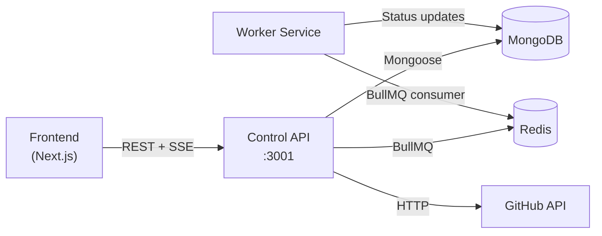
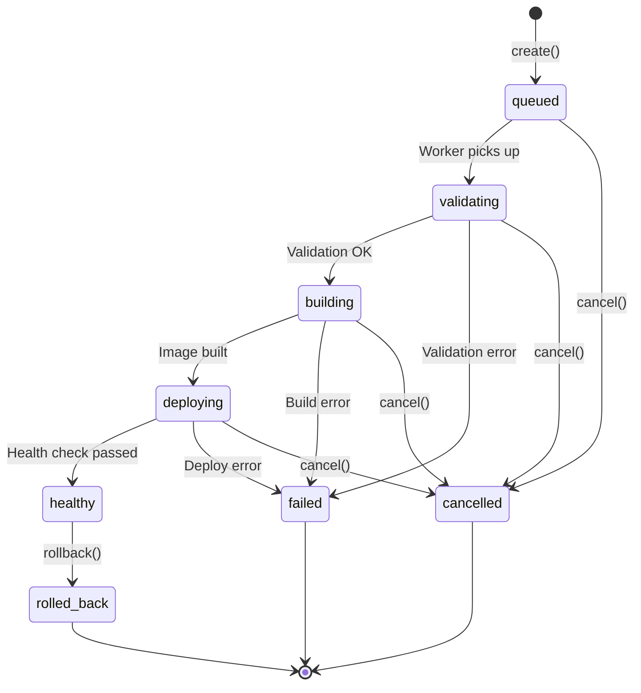

# 03 — Control API

> **Service**: `control-api` | **Runtime**: Node.js + Express + TypeScript | **Port**: `3001`
> **Data Stores**: MongoDB (primary), Redis (BullMQ queues + session store backup)

---

## Table of Contents

1. [Overview](#overview)
2. [Directory Structure](#directory-structure)
3. [Configuration Layer](#configuration-layer)
4. [Module: Auth](#module-auth)
5. [Module: Projects](#module-projects)
6. [Module: Services](#module-services)
7. [Module: Deployments](#module-deployments)
8. [Module: Env Vars](#module-env-vars)
9. [Module: Domains](#module-domains)
10. [Module: Connections](#module-connections)
11. [Module: Resources](#module-resources)
12. [Module: Webhooks](#module-webhooks)
13. [Provider Adapter Pattern](#provider-adapter-pattern)
14. [BullMQ Queues](#bullmq-queues)
15. [Shared Utilities](#shared-utilities)
16. [Middleware](#middleware)
17. [Error Handling](#error-handling)
18. [TDD Approach](#tdd-approach)

---

## Overview

The Control API is the **single source of truth** for all ShipYard platform state. It:

- Authenticates users via GitHub OAuth and manages server-side sessions
- Provides CRUD for all domain entities (Projects, Services, Deployments, Env Vars, Domains, etc.)
- Enqueues deployment jobs to BullMQ, which the **Worker** service consumes
- Streams deployment logs and events to the frontend via SSE
- Abstracts cloud/homelab providers behind a unified adapter interface



> [!IMPORTANT]
> The Control API **never** runs Docker or calls cloud provider APIs for deployment work — that is the Worker's responsibility. The Control API only enqueues jobs and reads state.

---

## Directory Structure

```
control-api/
├── src/
│   ├── app.ts                    # Express app factory
│   ├── server.ts                 # HTTP server entry point
│   ├── config/
│   │   ├── env.ts                # Validated env vars (zod)
│   │   ├── db.ts                 # Mongoose connection
│   │   └── redis.ts              # ioredis client singleton
│   ├── middleware/
│   │   ├── auth.middleware.ts    # requireAuth guard
│   │   ├── error.middleware.ts   # global error handler
│   │   └── validate.middleware.ts# Zod DTO validation
│   ├── modules/
│   │   ├── auth/
│   │   │   ├── auth.routes.ts
│   │   │   ├── auth.controller.ts
│   │   │   ├── auth.service.ts
│   │   │   └── auth.types.ts
│   │   ├── projects/
│   │   │   ├── projects.routes.ts
│   │   │   ├── projects.controller.ts
│   │   │   ├── projects.service.ts
│   │   │   ├── project.model.ts
│   │   │   └── projects.dto.ts
│   │   ├── services/
│   │   │   ├── services.routes.ts
│   │   │   ├── services.controller.ts
│   │   │   ├── services.service.ts
│   │   │   ├── service.model.ts
│   │   │   └── services.dto.ts
│   │   ├── deployments/
│   │   │   ├── deployments.routes.ts
│   │   │   ├── deployments.controller.ts
│   │   │   ├── deployments.service.ts
│   │   │   ├── deployment.model.ts
│   │   │   ├── deployment-outbox.model.ts
│   │   │   ├── deployment.queue.ts
│   │   │   └── deployments.types.ts
│   │   ├── env-vars/
│   │   │   ├── env.routes.ts
│   │   │   ├── env.controller.ts
│   │   │   ├── env.service.ts
│   │   │   ├── env-var.model.ts
│   │   │   └── encryption.service.ts
│   │   ├── domains/
│   │   ├── connections/
│   │   ├── resources/
│   │   └── webhooks/
│   ├── providers/
│   │   ├── provider.interface.ts
│   │   ├── provider.factory.ts
│   │   ├── homelab/
│   │   │   └── homelab.provider.ts
│   │   ├── vercel/
│   │   │   └── vercel.provider.ts
│   │   ├── neon/
│   │   │   └── neon.provider.ts
│   │   └── atlas/
│   │       └── atlas.provider.ts
│   ├── queues/
│   │   └── deployment.queue.ts   # BullMQ producer
│   └── shared/
│       ├── errors/
│       │   └── AppError.ts
│       ├── utils/
│       │   ├── asyncHandler.ts
│       │   ├── paginate.ts
│       │   └── generateId.ts
│       └── types/
│           └── express.d.ts      # req.user augmentation
└── tests/
    ├── unit/
    │   ├── auth/
    │   ├── projects/
    │   ├── services/
    │   └── deployments/
    ├── integration/
    │   ├── auth.routes.test.ts
    │   ├── projects.routes.test.ts
    │   └── deployments.routes.test.ts
    └── helpers/
        ├── db.helper.ts          # in-memory mongo setup
        ├── session.helper.ts     # signed cookie factory
        └── nock.helper.ts        # GitHub API mocks
```

---

## Configuration Layer

### `src/config/env.ts`

All environment variables are validated at startup via Zod. The app **crashes immediately** if any required var is missing — fail-fast over silent misconfiguration.

```typescript
// src/config/env.ts
import { z } from "zod";

const envSchema = z.object({
  NODE_ENV: z.enum(["development", "test", "production"]).default("development"),
  PORT: z.coerce.number().default(3001),

  MONGODB_URI: z.string().url(),
  REDIS_URL: z.string().url(),

  SESSION_SECRET: z.string().min(32),
  SESSION_NAME: z.string().default("shipyard.sid"),

  GITHUB_CLIENT_ID: z.string(),
  GITHUB_CLIENT_SECRET: z.string(),
  GITHUB_CALLBACK_URL: z.string().url(),

  ENCRYPTION_KEY: z.string().length(64), // 32 bytes hex-encoded
  FRONTEND_URL: z.string().url(),
});

export type Env = z.infer<typeof envSchema>;
export const env = envSchema.parse(process.env);
```

### `src/config/db.ts`

```typescript
// src/config/db.ts
import mongoose from "mongoose";
import { env } from "./env";

export async function connectDb(): Promise<void> {
  await mongoose.connect(env.MONGODB_URI, {
    serverSelectionTimeoutMS: 5000,
  });
}
```

### `src/config/redis.ts`

```typescript
// src/config/redis.ts
import { Redis } from "ioredis";
import { env } from "./env";

// Single connection, reused by BullMQ and outbox worker
export const redis = new Redis(env.REDIS_URL, {
  maxRetriesPerRequest: null, // required by BullMQ
});
```

---

## Module: Auth

> **Why server-side sessions?** The GitHub OAuth access token grants full repo access. Storing it client-side (even in an HTTP-only cookie) risks leakage in XSS, SSRF, or log scraping scenarios. Server-side sessions mean the token never leaves the server. The browser only holds an opaque session ID in an HTTP-only, SameSite=Lax cookie.

### `src/modules/auth/auth.types.ts`

```typescript
// src/modules/auth/auth.types.ts

export interface GithubUser {
  id: number;
  login: string;          // GitHub username
  name: string | null;
  email: string | null;
  avatar_url: string;
}

export interface Repo {
  id: number;
  full_name: string;      // "owner/repo"
  name: string;
  private: boolean;
  html_url: string;
  default_branch: string;
  updated_at: string;
}

export interface Branch {
  name: string;
  commit: { sha: string; url: string };
  protected: boolean;
}

export interface Commit {
  sha: string;
  commit: {
    message: string;
    author: { name: string; date: string };
  };
  author: { login: string; avatar_url: string } | null;
}

export interface SessionData {
  userId: string;
  githubToken: string;    // AES-256-GCM encrypted; never the raw token
}

// Express session augmentation
declare module "express-session" {
  interface SessionData {
    userId: string;
    githubToken: string;
  }
}
```

### `src/modules/auth/auth.routes.ts`

```typescript
// src/modules/auth/auth.routes.ts
import { Router } from "express";
import { AuthController } from "./auth.controller";
import { requireAuth } from "../../middleware/auth.middleware";

const router = Router();
const ctrl = new AuthController();

// Public — OAuth handshake
router.get("/github", ctrl.initiateGithubOAuth);
router.get("/github/callback", ctrl.handleGithubCallback);

// Protected — requires active session
router.get("/me", requireAuth, ctrl.getMe);
router.post("/logout", requireAuth, ctrl.logout);

// Protected — GitHub proxy (avoids CORS token exposure on frontend)
router.get("/github/repos", requireAuth, ctrl.getRepos);
router.get("/github/repos/:owner/:repo/branches", requireAuth, ctrl.getBranches);
router.get("/github/repos/:owner/:repo/commits", requireAuth, ctrl.getCommits);

export { router as authRouter };
```

**Route Summary**

| Method | Path | Auth | Description |
|--------|------|------|-------------|
| `GET` | `/auth/github` | ❌ | Redirect to GitHub OAuth consent |
| `GET` | `/auth/github/callback` | ❌ | OAuth callback; creates session |
| `GET` | `/auth/me` | ✅ | Returns current user profile |
| `POST` | `/auth/logout` | ✅ | Destroys session |
| `GET` | `/auth/github/repos` | ✅ | Lists user's GitHub repos |
| `GET` | `/auth/github/repos/:owner/:repo/branches` | ✅ | Lists branches for a repo |
| `GET` | `/auth/github/repos/:owner/:repo/commits` | ✅ | Lists recent commits |

### `src/modules/auth/auth.controller.ts`

```typescript
// src/modules/auth/auth.controller.ts
import { Request, Response } from "express";
import { AuthService } from "./auth.service";
import { asyncHandler } from "../../shared/utils/asyncHandler";
import { env } from "../../config/env";

export class AuthController {
  private authService: AuthService;

  constructor(authService = new AuthService()) {
    this.authService = authService;
  }

  /**
   * GET /auth/github
   * Builds the GitHub authorization URL with client_id, scope, and a CSRF state
   * param, then 302-redirects the browser.
   *
   * @returns 302 redirect to https://github.com/login/oauth/authorize
   */
  initiateGithubOAuth = asyncHandler(async (req: Request, res: Response) => {
    const state = crypto.randomUUID();
    req.session.oauthState = state;

    const params = new URLSearchParams({
      client_id: env.GITHUB_CLIENT_ID,
      redirect_uri: env.GITHUB_CALLBACK_URL,
      scope: "read:user user:email repo",
      state,
    });

    res.redirect(`https://github.com/login/oauth/authorize?${params}`);
  });

  /**
   * GET /auth/github/callback?code=...&state=...
   * 1. Validates CSRF state param against session
   * 2. Exchanges `code` for a GitHub access token
   * 3. Fetches GitHub user profile
   * 4. Upserts user in MongoDB
   * 5. Stores encrypted token + userId in session
   * 6. Redirects to frontend dashboard
   *
   * @returns 302 redirect to FRONTEND_URL/dashboard
   */
  handleGithubCallback = asyncHandler(async (req: Request, res: Response) => {
    const { code, state } = req.query as { code: string; state: string };

    if (state !== req.session.oauthState) {
      return res.status(400).json({ error: { code: "INVALID_STATE", message: "OAuth state mismatch" } });
    }
    delete req.session.oauthState;

    const rawToken = await this.authService.exchangeCodeForToken(code);
    const githubUser = await this.authService.fetchGithubUser(rawToken);
    const user = await this.authService.findOrCreateUser(githubUser);

    req.session.userId = user.id;
    req.session.githubToken = this.authService.encryptToken(rawToken);

    res.redirect(`${env.FRONTEND_URL}/dashboard`);
  });

  /**
   * GET /auth/me
   * Returns the current authenticated user's profile from MongoDB.
   *
   * @returns 200 { id, login, name, email, avatarUrl, createdAt }
   */
  getMe = asyncHandler(async (req: Request, res: Response) => {
    res.json({ user: req.user });
  });

  /**
   * POST /auth/logout
   * Destroys the server-side session and clears the session cookie.
   *
   * @returns 200 { message: "Logged out" }
   */
  logout = asyncHandler(async (req: Request, res: Response) => {
    req.session.destroy(() => {
      res.clearCookie(env.SESSION_NAME);
      res.json({ message: "Logged out" });
    });
  });

  /**
   * GET /auth/github/repos
   * Proxies a request to the GitHub API using the decrypted session token.
   * Supports ?page and ?per_page query params.
   *
   * @returns 200 Repo[]
   */
  getRepos = asyncHandler(async (req: Request, res: Response) => {
    const token = this.authService.decryptToken(req.session.githubToken!);
    const repos = await this.authService.getRepos(token);
    res.json({ repos });
  });

  /**
   * GET /auth/github/repos/:owner/:repo/branches
   * @returns 200 Branch[]
   */
  getBranches = asyncHandler(async (req: Request, res: Response) => {
    const { owner, repo } = req.params;
    const token = this.authService.decryptToken(req.session.githubToken!);
    const branches = await this.authService.getBranches(token, owner, repo);
    res.json({ branches });
  });

  /**
   * GET /auth/github/repos/:owner/:repo/commits
   * @query branch — optional branch name filter
   * @returns 200 Commit[]
   */
  getCommits = asyncHandler(async (req: Request, res: Response) => {
    const { owner, repo } = req.params;
    const token = this.authService.decryptToken(req.session.githubToken!);
    const commits = await this.authService.getCommits(token, owner, repo);
    res.json({ commits });
  });
}
```

### `src/modules/auth/auth.service.ts`

```typescript
// src/modules/auth/auth.service.ts
import axios from "axios";
import { UserModel } from "../projects/user.model";
import { EncryptionService } from "../env-vars/encryption.service";
import type { GithubUser, Repo, Branch, Commit } from "./auth.types";
import type { User } from "../../shared/types";

export class AuthService {
  private encryption: EncryptionService;

  constructor(encryption = new EncryptionService()) {
    this.encryption = encryption;
  }

  /**
   * POST to GitHub's token endpoint with the one-time code.
   * Returns the raw access_token string.
   */
  async exchangeCodeForToken(code: string): Promise<string> {
    const { data } = await axios.post(
      "https://github.com/login/oauth/access_token",
      { client_id: env.GITHUB_CLIENT_ID, client_secret: env.GITHUB_CLIENT_SECRET, code },
      { headers: { Accept: "application/json" } }
    );
    if (data.error) throw new AppError(data.error_description, 400, "GITHUB_OAUTH_ERROR");
    return data.access_token;
  }

  /**
   * Fetches the authenticated user's profile from GitHub /user endpoint.
   */
  async fetchGithubUser(token: string): Promise<GithubUser> {
    const { data } = await axios.get<GithubUser>("https://api.github.com/user", {
      headers: { Authorization: `Bearer ${token}` },
    });
    return data;
  }

  /**
   * Upserts a user document by githubId. Creates on first login,
   * updates login/name/avatar on subsequent logins (profile may change on GitHub).
   */
  async findOrCreateUser(githubUser: GithubUser): Promise<User> {
    return UserModel.findOneAndUpdate(
      { githubId: githubUser.id },
      {
        $set: {
          login: githubUser.login,
          name: githubUser.name,
          email: githubUser.email,
          avatarUrl: githubUser.avatar_url,
        },
        $setOnInsert: { _id: generateId("usr"), createdAt: new Date() },
      },
      { upsert: true, new: true }
    ).lean();
  }

  /**
   * Lists all repos accessible to the authenticated user, sorted by last push.
   * Paginates internally (fetches up to 100 per page) until GitHub returns < 100.
   */
  async getRepos(token: string): Promise<Repo[]> {
    const { data } = await axios.get<Repo[]>("https://api.github.com/user/repos", {
      headers: { Authorization: `Bearer ${token}` },
      params: { per_page: 100, sort: "pushed", affiliation: "owner,collaborator" },
    });
    return data;
  }

  /**
   * Lists branches for a specific repo.
   */
  async getBranches(token: string, owner: string, repo: string): Promise<Branch[]> {
    const { data } = await axios.get<Branch[]>(
      `https://api.github.com/repos/${owner}/${repo}/branches`,
      { headers: { Authorization: `Bearer ${token}` }, params: { per_page: 100 } }
    );
    return data;
  }

  /**
   * Lists the 30 most recent commits on the default (or specified) branch.
   */
  async getCommits(token: string, owner: string, repo: string): Promise<Commit[]> {
    const { data } = await axios.get<Commit[]>(
      `https://api.github.com/repos/${owner}/${repo}/commits`,
      { headers: { Authorization: `Bearer ${token}` }, params: { per_page: 30 } }
    );
    return data;
  }

  encryptToken(raw: string): string {
    return this.encryption.encrypt(raw);
  }

  decryptToken(encrypted: string): string {
    return this.encryption.decrypt(encrypted);
  }
}
```

### `src/middleware/auth.middleware.ts`

```typescript
// src/middleware/auth.middleware.ts
import { Request, Response, NextFunction } from "express";
import { UserModel } from "../modules/projects/user.model";

/**
 * requireAuth — Session guard middleware.
 *
 * Reads req.session.userId, fetches the User document, and attaches it to
 * req.user. Returns 401 if session is absent or user is not found in DB.
 *
 * Why DB lookup on each request?
 * We need to handle the case where a user account is deleted or suspended after
 * their session was created. A pure session check would allow "ghost" access.
 * This lookup is ~1ms on a warm MongoDB connection with a githubId index.
 */
export async function requireAuth(req: Request, res: Response, next: NextFunction) {
  const userId = req.session?.userId;
  if (!userId) {
    return res.status(401).json({ error: { code: "UNAUTHENTICATED", message: "Session required" } });
  }

  const user = await UserModel.findById(userId).lean();
  if (!user) {
    req.session.destroy(() => {});
    return res.status(401).json({ error: { code: "USER_NOT_FOUND", message: "User no longer exists" } });
  }

  req.user = user;
  next();
}
```

---

## Module: Projects

### `src/modules/projects/project.model.ts`

```typescript
// src/modules/projects/project.model.ts
import { Schema, model, Document } from "mongoose";

export interface IProject extends Document {
  _id: string;
  userId: string;
  name: string;
  githubUrl?: string;
  createdAt: Date;
  updatedAt: Date;
}

const projectSchema = new Schema<IProject>(
  {
    _id: { type: String },
    userId: { type: String, required: true, index: true },
    name: { type: String, required: true, trim: true },
    githubUrl: { type: String },
  },
  { timestamps: true }
);

// Compound index: one user cannot have two projects with the same name
projectSchema.index({ userId: 1, name: 1 }, { unique: true });

export const ProjectModel = model<IProject>("Project", projectSchema);
```

### `src/modules/projects/projects.dto.ts`

```typescript
// src/modules/projects/projects.dto.ts
import { z } from "zod";

export const createProjectSchema = z.object({
  name: z.string().min(2).max(64).regex(/^[a-zA-Z0-9\s\-_]+$/),
  githubUrl: z.string().url().optional(),
});

export const updateProjectSchema = z.object({
  name: z.string().min(2).max(64).optional(),
  githubUrl: z.string().url().nullable().optional(),
});

export type CreateProjectDto = z.infer<typeof createProjectSchema>;
export type UpdateProjectDto = z.infer<typeof updateProjectSchema>;
```

### `src/modules/projects/projects.routes.ts`

```typescript
// src/modules/projects/projects.routes.ts
import { Router } from "express";
import { ProjectsController } from "./projects.controller";
import { requireAuth } from "../../middleware/auth.middleware";
import { validateDto } from "../../middleware/validate.middleware";
import { createProjectSchema, updateProjectSchema } from "./projects.dto";

const router = Router();
const ctrl = new ProjectsController();

router.use(requireAuth); // all project routes require auth

router.post("/", validateDto(createProjectSchema), ctrl.createProject);
router.get("/", ctrl.listProjects);
router.get("/:projectId", ctrl.getProject);
router.patch("/:projectId", validateDto(updateProjectSchema), ctrl.updateProject);
router.delete("/:projectId", ctrl.deleteProject);

export { router as projectsRouter };
```

**Route Summary**

| Method | Path | Description |
|--------|------|-------------|
| `POST` | `/projects` | Create a new project |
| `GET` | `/projects` | List all projects for current user |
| `GET` | `/projects/:projectId` | Get a single project |
| `PATCH` | `/projects/:projectId` | Update project metadata |
| `DELETE` | `/projects/:projectId` | Delete project (with safeguard) |

### `src/modules/projects/projects.controller.ts`

```typescript
// src/modules/projects/projects.controller.ts
import { Request, Response } from "express";
import { ProjectsService } from "./projects.service";
import { asyncHandler } from "../../shared/utils/asyncHandler";

export class ProjectsController {
  constructor(private svc = new ProjectsService()) {}

  /**
   * POST /projects
   * @body CreateProjectDto
   * @returns 201 { project }
   */
  createProject = asyncHandler(async (req: Request, res: Response) => {
    const project = await this.svc.create(req.user!.id, req.body);
    res.status(201).json({ project });
  });

  /**
   * GET /projects
   * @returns 200 { projects: Project[], total: number }
   */
  listProjects = asyncHandler(async (req: Request, res: Response) => {
    const projects = await this.svc.findAllByUser(req.user!.id);
    res.json({ projects, total: projects.length });
  });

  /**
   * GET /projects/:projectId
   * @returns 200 { project } | 404 | 403
   */
  getProject = asyncHandler(async (req: Request, res: Response) => {
    const project = await this.svc.findOne(req.params.projectId, req.user!.id);
    res.json({ project });
  });

  /**
   * PATCH /projects/:projectId
   * @body UpdateProjectDto
   * @returns 200 { project }
   */
  updateProject = asyncHandler(async (req: Request, res: Response) => {
    const project = await this.svc.update(req.params.projectId, req.user!.id, req.body);
    res.json({ project });
  });

  /**
   * DELETE /projects/:projectId
   * @returns 204 No Content | 409 if active deployments exist
   */
  deleteProject = asyncHandler(async (req: Request, res: Response) => {
    await this.svc.delete(req.params.projectId, req.user!.id);
    res.status(204).send();
  });
}
```

### `src/modules/projects/projects.service.ts`

```typescript
// src/modules/projects/projects.service.ts
import { ProjectModel, IProject } from "./project.model";
import { DeploymentModel } from "../deployments/deployment.model";
import { ServiceModel } from "../services/service.model";
import { AppError } from "../../shared/errors/AppError";
import { generateId } from "../../shared/utils/generateId";
import type { CreateProjectDto, UpdateProjectDto } from "./projects.dto";

export class ProjectsService {
  /**
   * Creates a new project owned by userId.
   * Throws 409 if the user already has a project with this name.
   */
  async create(userId: string, dto: CreateProjectDto): Promise<IProject> {
    const id = generateId("prj");
    try {
      return await ProjectModel.create({ _id: id, userId, ...dto });
    } catch (err: any) {
      if (err.code === 11000) {
        throw new AppError(`Project named "${dto.name}" already exists`, 409, "DUPLICATE_PROJECT");
      }
      throw err;
    }
  }

  /** Returns all projects belonging to the user, sorted newest first. */
  async findAllByUser(userId: string): Promise<IProject[]> {
    return ProjectModel.find({ userId }).sort({ createdAt: -1 }).lean();
  }

  /**
   * Finds a single project and verifies ownership.
   * Throws 404 if not found, 403 if userId doesn't match.
   *
   * Ownership check pattern: always resolve the resource first, then check
   * ownership. Returning 404 for "not found OR wrong user" leaks less info,
   * but here we distinguish 403 to give clear feedback in the UI.
   */
  async findOne(projectId: string, userId: string): Promise<IProject> {
    const project = await ProjectModel.findById(projectId).lean();
    if (!project) throw new AppError("Project not found", 404, "PROJECT_NOT_FOUND");
    if (project.userId !== userId) throw new AppError("Forbidden", 403, "FORBIDDEN");
    return project;
  }

  async update(projectId: string, userId: string, dto: UpdateProjectDto): Promise<IProject> {
    await this.findOne(projectId, userId); // ownership check
    const updated = await ProjectModel.findByIdAndUpdate(
      projectId,
      { $set: dto },
      { new: true, runValidators: true }
    ).lean();
    return updated!;
  }

  /**
   * Deletes a project ONLY if no active deployments exist across any of its services.
   *
   * Why: A running deployment owns live infrastructure (containers, databases).
   * Deleting the project record while the worker is mid-deploy would orphan
   * those resources with no way to track or teardown.
   */
  async delete(projectId: string, userId: string): Promise<void> {
    await this.findOne(projectId, userId); // 404 / 403 guard

    // Gather all service IDs under this project
    const services = await ServiceModel.find({ projectId }, "_id").lean();
    const serviceIds = services.map((s) => s._id);

    const ACTIVE_STATES = ["queued", "validating", "building", "deploying"];
    const activeCount = await DeploymentModel.countDocuments({
      serviceId: { $in: serviceIds },
      status: { $in: ACTIVE_STATES },
    });

    if (activeCount > 0) {
      throw new AppError(
        "Cannot delete project: active deployments in progress. Cancel them first.",
        409,
        "ACTIVE_DEPLOYMENTS"
      );
    }

    // Cascade delete: services, env vars, domains, etc. handled via pre-hook
    await ProjectModel.findByIdAndDelete(projectId);
  }
}
```

---

## Module: Services

A **Service** is a deployable unit within a Project (e.g., a web app, a background worker, a database). Multiple services can belong to one project.

### `src/modules/services/service.model.ts`

```typescript
// src/modules/services/service.model.ts
import { Schema, model, Document } from "mongoose";

export type ServiceType = "web" | "worker" | "cron" | "database" | "static";

export interface IService extends Document {
  _id: string;
  projectId: string;
  name: string;
  type: ServiceType;
  repository?: string;       // "owner/repo"
  branch?: string;
  rootDirectory?: string;    // monorepo support
  buildCommand?: string;
  preDeployCommand?: string; // e.g. DB migrations
  startCommand?: string;
  serviceConfig?: Record<string, unknown>; // provider-specific config
  createdAt: Date;
  updatedAt: Date;
}

const serviceSchema = new Schema<IService>(
  {
    _id: { type: String },
    projectId: { type: String, required: true, index: true },
    name: { type: String, required: true, trim: true },
    type: { type: String, enum: ["web", "worker", "cron", "database", "static"], required: true },
    repository: String,
    branch: String,
    rootDirectory: { type: String, default: "/" },
    buildCommand: String,
    preDeployCommand: String,
    startCommand: String,
    serviceConfig: { type: Schema.Types.Mixed, default: {} },
  },
  { timestamps: true }
);

serviceSchema.index({ projectId: 1, name: 1 }, { unique: true });

export const ServiceModel = model<IService>("Service", serviceSchema);
```

### `src/modules/services/services.dto.ts`

```typescript
// src/modules/services/services.dto.ts
import { z } from "zod";

const serviceTypes = ["web", "worker", "cron", "database", "static"] as const;

export const createServiceSchema = z.object({
  name: z.string().min(2).max(64),
  type: z.enum(serviceTypes),
  repository: z.string().optional(),         // "owner/repo"
  branch: z.string().optional(),
  rootDirectory: z.string().default("/"),
  buildCommand: z.string().optional(),
  preDeployCommand: z.string().optional(),
  startCommand: z.string().optional(),
  serviceConfig: z.record(z.unknown()).optional(),
});

export const updateServiceSchema = createServiceSchema.partial();

export type CreateServiceDto = z.infer<typeof createServiceSchema>;
export type UpdateServiceDto = z.infer<typeof updateServiceSchema>;
```

### `src/modules/services/services.controller.ts`

```typescript
// src/modules/services/services.controller.ts
import { Request, Response } from "express";
import { ServiceService } from "./services.service";
import { asyncHandler } from "../../shared/utils/asyncHandler";

export class ServiceController {
  constructor(private svc = new ServiceService()) {}

  /**
   * POST /projects/:projectId/services
   * @body CreateServiceDto
   * @returns 201 { service }
   */
  addService = asyncHandler(async (req: Request, res: Response) => {
    const service = await this.svc.create(req.params.projectId, req.body);
    res.status(201).json({ service });
  });

  /**
   * GET /projects/:projectId/services
   * @returns 200 { services: Service[] }
   */
  listServices = asyncHandler(async (req: Request, res: Response) => {
    const services = await this.svc.findAll(req.params.projectId);
    res.json({ services });
  });

  /**
   * GET /projects/:projectId/services/:serviceId
   * @returns 200 { service } | 404
   */
  getService = asyncHandler(async (req: Request, res: Response) => {
    const service = await this.svc.findOne(req.params.serviceId, req.params.projectId);
    res.json({ service });
  });

  /**
   * PATCH /projects/:projectId/services/:serviceId
   * @body UpdateServiceDto
   * @returns 200 { service }
   */
  updateService = asyncHandler(async (req: Request, res: Response) => {
    const service = await this.svc.update(req.params.serviceId, req.params.projectId, req.body);
    res.json({ service });
  });

  /**
   * DELETE /projects/:projectId/services/:serviceId
   * @returns 204 | 409 if active deployments
   */
  removeService = asyncHandler(async (req: Request, res: Response) => {
    await this.svc.remove(req.params.serviceId, req.params.projectId);
    res.status(204).send();
  });
}
```

### `src/modules/services/services.service.ts`

```typescript
// src/modules/services/services.service.ts
import { ServiceModel, IService } from "./service.model";
import { DeploymentModel } from "../deployments/deployment.model";
import { AppError } from "../../shared/errors/AppError";
import { generateId } from "../../shared/utils/generateId";
import type { CreateServiceDto, UpdateServiceDto } from "./services.dto";

export class ServiceService {
  async create(projectId: string, dto: CreateServiceDto): Promise<IService> {
    try {
      return await ServiceModel.create({ _id: generateId("svc"), projectId, ...dto });
    } catch (err: any) {
      if (err.code === 11000) {
        throw new AppError(`Service named "${dto.name}" already exists in this project`, 409, "DUPLICATE_SERVICE");
      }
      throw err;
    }
  }

  async findAll(projectId: string): Promise<IService[]> {
    return ServiceModel.find({ projectId }).sort({ createdAt: -1 }).lean();
  }

  async findOne(serviceId: string, projectId: string): Promise<IService> {
    const service = await ServiceModel.findOne({ _id: serviceId, projectId }).lean();
    if (!service) throw new AppError("Service not found", 404, "SERVICE_NOT_FOUND");
    return service;
  }

  async update(serviceId: string, projectId: string, dto: UpdateServiceDto): Promise<IService> {
    await this.findOne(serviceId, projectId); // existence check
    const updated = await ServiceModel.findByIdAndUpdate(
      serviceId,
      { $set: dto },
      { new: true, runValidators: true }
    ).lean();
    return updated!;
  }

  async remove(serviceId: string, projectId: string): Promise<void> {
    await this.findOne(serviceId, projectId);

    const ACTIVE_STATES = ["queued", "validating", "building", "deploying"];
    const activeCount = await DeploymentModel.countDocuments({
      serviceId,
      status: { $in: ACTIVE_STATES },
    });
    if (activeCount > 0) {
      throw new AppError("Service has active deployments. Cancel them first.", 409, "ACTIVE_DEPLOYMENTS");
    }
    await ServiceModel.findByIdAndDelete(serviceId);
  }
}
```

---

## Module: Deployments

> [!IMPORTANT]
> The Control API **only creates the Deployment record and enqueues the job**. It never executes build or deploy logic. All execution happens in the Worker service.

### `deployments.types.ts`

```typescript
// src/modules/deployments/deployments.types.ts

export enum DeploymentState {
  QUEUED      = "queued",
  VALIDATING  = "validating",
  BUILDING    = "building",
  DEPLOYING   = "deploying",
  HEALTHY     = "healthy",
  FAILED      = "failed",
  CANCELLED   = "cancelled",
  ROLLED_BACK = "rolled_back",
}

/** Shape of the job payload pushed to BullMQ */
export interface DeploymentJob {
  deploymentId: string;
  serviceId: string;
  /** Snapshot of service config at trigger time — immutable */
  configSnapshot: {
    repository: string;
    branch: string;
    rootDirectory: string;
    buildCommand?: string;
    preDeployCommand?: string;
    startCommand?: string;
    serviceConfig?: Record<string, unknown>;
  };
  imageTag: string;  // e.g. "svc_abc123:sha-deadbeef"
}

/** Unified status returned by provider adapters */
export interface ProviderStatus {
  state: DeploymentState;
  externalId?: string;
  message?: string;
}

export interface DeployResult {
  externalId: string;   // Provider-side resource ID
  url?: string;         // Public URL if applicable
}
```

### State Machine



### `src/modules/deployments/deployment.model.ts`

```typescript
// src/modules/deployments/deployment.model.ts
import { Schema, model, Document } from "mongoose";
import { DeploymentState } from "./deployments.types";

export interface IDeployment extends Document {
  _id: string;
  serviceId: string;
  projectId: string;
  triggeredBy: string;        // userId
  status: DeploymentState;
  configSnapshot: Record<string, unknown>;
  imageTag?: string;
  externalId?: string;        // Provider resource ID
  url?: string;
  statusHistory: Array<{ status: DeploymentState; at: Date }>;
  createdAt: Date;
  updatedAt: Date;
}

const deploymentSchema = new Schema<IDeployment>(
  {
    _id: { type: String },
    serviceId: { type: String, required: true, index: true },
    projectId: { type: String, required: true, index: true },
    triggeredBy: { type: String, required: true },
    status: {
      type: String,
      enum: Object.values(DeploymentState),
      default: DeploymentState.QUEUED,
      index: true,
    },
    configSnapshot: { type: Schema.Types.Mixed, required: true },
    imageTag: String,
    externalId: String,
    url: String,
    statusHistory: [
      {
        status: { type: String, enum: Object.values(DeploymentState) },
        at: Date,
      },
    ],
  },
  { timestamps: true }
);

export const DeploymentModel = model<IDeployment>("Deployment", deploymentSchema);
```

### `src/modules/deployments/deployment-outbox.model.ts`

```typescript
// src/modules/deployments/deployment-outbox.model.ts
import { Schema, model, Document } from "mongoose";

/**
 * Outbox Pattern: An outbox document is written in the SAME MongoDB transaction
 * as the Deployment creation. A separate lightweight outbox worker polls this
 * collection, publishes the job to BullMQ, then marks the record as published.
 *
 * Why: Without this, the sequence "save to DB" then "enqueue to Redis" is NOT
 * atomic. A crash between the two steps leaves an orphan DB record with no
 * corresponding queue job — the deployment appears queued forever.
 * The outbox guarantees at-least-once delivery.
 */
export interface IDeploymentOutbox extends Document {
  deploymentId: string;
  payload: Record<string, unknown>;
  published: boolean;
  publishedAt?: Date;
  createdAt: Date;
}

const outboxSchema = new Schema<IDeploymentOutbox>({
  deploymentId: { type: String, required: true, unique: true },
  payload: { type: Schema.Types.Mixed, required: true },
  published: { type: Boolean, default: false, index: true },
  publishedAt: Date,
  createdAt: { type: Date, default: Date.now },
});

export const DeploymentOutboxModel = model<IDeploymentOutbox>("DeploymentOutbox", outboxSchema);
```

### `src/modules/deployments/deployments.controller.ts`

```typescript
// src/modules/deployments/deployments.controller.ts
import { Request, Response } from "express";
import { DeploymentService } from "./deployments.service";
import { asyncHandler } from "../../shared/utils/asyncHandler";

export class DeploymentController {
  constructor(private svc = new DeploymentService()) {}

  /**
   * POST /projects/:projectId/services/:serviceId/deployments
   * Creates a Deployment record + outbox entry in a MongoDB transaction,
   * then the outbox worker publishes to BullMQ.
   *
   * @returns 202 Accepted { deployment } — NOT 201, because the work is async
   */
  startDeployment = asyncHandler(async (req: Request, res: Response) => {
    const deployment = await this.svc.create(
      req.params.serviceId,
      req.body,
      req.user!.id
    );
    res.status(202).json({ deployment });
  });

  /**
   * GET /projects/:projectId/deployments
   * @query page, limit, status (filter)
   * @returns 200 { deployments, total, page, limit }
   */
  listDeployments = asyncHandler(async (req: Request, res: Response) => {
    const { page = 1, limit = 20, status } = req.query;
    const result = await this.svc.findAll(req.params.projectId, {
      page: Number(page),
      limit: Number(limit),
      status: status as string | undefined,
    });
    res.json(result);
  });

  /**
   * GET /deployments/:deploymentId
   * @returns 200 { deployment } | 404
   */
  getDeployment = asyncHandler(async (req: Request, res: Response) => {
    const deployment = await this.svc.findOne(
      req.params.deploymentId,
      req.params.projectId
    );
    res.json({ deployment });
  });

  /**
   * POST /deployments/:deploymentId/cancel
   * Transitions state to "cancelled". Returns 409 if state transition invalid.
   * @returns 200 { deployment }
   */
  cancelDeployment = asyncHandler(async (req: Request, res: Response) => {
    await this.svc.cancel(req.params.deploymentId);
    res.json({ message: "Deployment cancelled" });
  });

  /**
   * POST /deployments/:deploymentId/rollback
   * Finds the last HEALTHY deployment for the same service, clones its
   * configSnapshot, and creates a new Deployment.
   * @returns 202 { deployment }
   */
  rollbackDeployment = asyncHandler(async (req: Request, res: Response) => {
    const deployment = await this.svc.rollback(
      req.params.deploymentId,
      req.user!.id
    );
    res.status(202).json({ deployment });
  });

  /**
   * GET /deployments/:deploymentId/logs
   * Returns all logs as a JSON array (non-streaming).
   * @returns 200 { logs: LogEntry[] }
   */
  getLogs = asyncHandler(async (req: Request, res: Response) => {
    const logs = await this.svc.getLogs(req.params.deploymentId);
    res.json({ logs });
  });

  /**
   * GET /deployments/:deploymentId/events
   * Returns all state-transition events as a JSON array.
   * @returns 200 { events: EventEntry[] }
   */
  getEvents = asyncHandler(async (req: Request, res: Response) => {
    const events = await this.svc.getEvents(req.params.deploymentId);
    res.json({ events });
  });

  /**
   * GET /deployments/:deploymentId/stream
   * Server-Sent Events endpoint. The client subscribes once and receives
   * real-time log lines and state change events until deployment finishes
   * or the connection drops.
   *
   * SSE headers are set immediately (200) so the browser starts listening.
   * Events are pushed via `data: <json>\n\n` format.
   */
  streamDeployment = asyncHandler(async (req: Request, res: Response) => {
    res.setHeader("Content-Type", "text/event-stream");
    res.setHeader("Cache-Control", "no-cache");
    res.setHeader("Connection", "keep-alive");
    res.flushHeaders();

    await this.svc.streamLogs(req.params.deploymentId, res);
  });
}
```

### `src/modules/deployments/deployments.service.ts`

```typescript
// src/modules/deployments/deployments.service.ts
import mongoose from "mongoose";
import { Response } from "express";
import { DeploymentModel, IDeployment } from "./deployment.model";
import { DeploymentOutboxModel } from "./deployment-outbox.model";
import { ServiceModel } from "../services/service.model";
import { AppError } from "../../shared/errors/AppError";
import { generateId } from "../../shared/utils/generateId";
import { DeploymentState, type DeploymentJob } from "./deployments.types";

const CANCELLABLE_STATES = [
  DeploymentState.QUEUED,
  DeploymentState.VALIDATING,
  DeploymentState.BUILDING,
  DeploymentState.DEPLOYING,
];

export class DeploymentService {
  /**
   * Creates a Deployment + Outbox document in a single MongoDB session (transaction).
   *
   * The outbox worker (separate process) polls DeploymentOutbox where
   * published=false, pushes to BullMQ, then sets published=true.
   *
   * At-least-once delivery: if the outbox worker crashes after publishing but
   * before marking published=true, it will re-publish. The Worker must be
   * idempotent on deploymentId.
   */
  async create(serviceId: string, dto: any, userId: string): Promise<IDeployment> {
    const service = await ServiceModel.findById(serviceId).lean();
    if (!service) throw new AppError("Service not found", 404, "SERVICE_NOT_FOUND");

    const deploymentId = generateId("dep");
    const imageTag = `${serviceId}:${Date.now()}`;

    const configSnapshot = {
      repository: service.repository,
      branch: service.branch,
      rootDirectory: service.rootDirectory,
      buildCommand: service.buildCommand,
      preDeployCommand: service.preDeployCommand,
      startCommand: service.startCommand,
      serviceConfig: service.serviceConfig,
    };

    const job: DeploymentJob = { deploymentId, serviceId, configSnapshot, imageTag };

    const session = await mongoose.startSession();
    session.startTransaction();

    try {
      const [deployment] = await DeploymentModel.create(
        [
          {
            _id: deploymentId,
            serviceId,
            projectId: service.projectId,
            triggeredBy: userId,
            status: DeploymentState.QUEUED,
            configSnapshot,
            imageTag,
            statusHistory: [{ status: DeploymentState.QUEUED, at: new Date() }],
          },
        ],
        { session }
      );

      await DeploymentOutboxModel.create(
        [{ deploymentId, payload: job, published: false }],
        { session }
      );

      await session.commitTransaction();
      return deployment;
    } catch (err) {
      await session.abortTransaction();
      throw err;
    } finally {
      session.endSession();
    }
  }

  async findAll(projectId: string, opts: { page: number; limit: number; status?: string }) {
    const filter: any = { projectId };
    if (opts.status) filter.status = opts.status;
    const [deployments, total] = await Promise.all([
      DeploymentModel.find(filter)
        .sort({ createdAt: -1 })
        .skip((opts.page - 1) * opts.limit)
        .limit(opts.limit)
        .lean(),
      DeploymentModel.countDocuments(filter),
    ]);
    return { deployments, total, page: opts.page, limit: opts.limit };
  }

  async findOne(deploymentId: string, projectId: string): Promise<IDeployment> {
    const dep = await DeploymentModel.findOne({ _id: deploymentId, projectId }).lean();
    if (!dep) throw new AppError("Deployment not found", 404, "DEPLOYMENT_NOT_FOUND");
    return dep;
  }

  /**
   * Transitions state to CANCELLED.
   * Only allowed from CANCELLABLE_STATES — enforced via transitionState().
   * The Worker checks the DB status before each phase; if it sees CANCELLED,
   * it stops and cleans up.
   */
  async cancel(deploymentId: string): Promise<void> {
    await this.transitionState(deploymentId, DeploymentState.CANCELLED, CANCELLABLE_STATES);
  }

  /**
   * Creates a new deployment using the configSnapshot from the most recent
   * HEALTHY deployment for the same service.
   *
   * Why snapshot approach over re-running the current config?
   * The current service config may have changed. Rollback must be
   * deterministic — it replays the exact same artifact, not just the same
   * source code settings.
   */
  async rollback(deploymentId: string, userId: string): Promise<IDeployment> {
    const target = await DeploymentModel.findById(deploymentId).lean();
    if (!target) throw new AppError("Deployment not found", 404, "DEPLOYMENT_NOT_FOUND");

    const lastHealthy = await DeploymentModel.findOne({
      serviceId: target.serviceId,
      status: DeploymentState.HEALTHY,
      _id: { $ne: deploymentId },
    })
      .sort({ createdAt: -1 })
      .lean();

    if (!lastHealthy) {
      throw new AppError("No healthy deployment found to roll back to", 404, "NO_HEALTHY_DEPLOYMENT");
    }

    // Mark current as rolled_back
    await this.transitionState(deploymentId, DeploymentState.ROLLED_BACK, [DeploymentState.HEALTHY]);

    // Create new deployment from healthy snapshot
    return this.create(target.serviceId, lastHealthy.configSnapshot, userId);
  }

  async getLogs(deploymentId: string) {
    // Logs are stored in a separate LogEntry collection by the Worker
    const { LogModel } = await import("../deployments/log.model");
    return LogModel.find({ deploymentId }).sort({ timestamp: 1 }).lean();
  }

  async getEvents(deploymentId: string) {
    const dep = await DeploymentModel.findById(deploymentId).lean();
    if (!dep) throw new AppError("Deployment not found", 404, "DEPLOYMENT_NOT_FOUND");
    return dep.statusHistory;
  }

  /**
   * SSE streaming: polls DB every 1s for new log entries and state changes.
   * Terminates when deployment reaches a terminal state or client disconnects.
   *
   * Why polling instead of MongoDB change streams?
   * Change streams require a replica set or Atlas. For homelab deployments
   * on a single Mongo node, polling every 1s is simpler and sufficient.
   * Switching to change streams later is a drop-in upgrade.
   */
  async streamLogs(deploymentId: string, res: Response): Promise<void> {
    const TERMINAL_STATES = [
      DeploymentState.HEALTHY,
      DeploymentState.FAILED,
      DeploymentState.CANCELLED,
      DeploymentState.ROLLED_BACK,
    ];
    const { LogModel } = await import("../deployments/log.model");

    let lastLogId: string | null = null;
    let done = false;
    res.on("close", () => { done = true; });

    const push = (event: string, data: unknown) => {
      res.write(`event: ${event}\ndata: ${JSON.stringify(data)}\n\n`);
    };

    const poll = async () => {
      if (done) return;

      const dep = await DeploymentModel.findById(deploymentId).lean();
      if (!dep) { res.end(); return; }

      // Fetch new logs since last seen
      const query: any = { deploymentId };
      if (lastLogId) query._id = { $gt: lastLogId };
      const newLogs = await LogModel.find(query).sort({ _id: 1 }).lean();

      for (const log of newLogs) {
        push("log", log);
        lastLogId = log._id.toString();
      }

      push("state", { status: dep.status });

      if (TERMINAL_STATES.includes(dep.status)) {
        push("done", { status: dep.status });
        res.end();
        return;
      }

      setTimeout(poll, 1000);
    };

    await poll();
  }

  /**
   * Atomic state transition with guard on current state.
   *
   * Uses findOneAndUpdate with a filter that includes the expected current states.
   * If the document doesn't match (wrong state), the update returns null and we throw.
   * This prevents concurrent transitions (e.g., two cancel requests racing).
   */
  async transitionState(
    deploymentId: string,
    newState: DeploymentState,
    allowedFrom: DeploymentState[]
  ): Promise<void> {
    const result = await DeploymentModel.findOneAndUpdate(
      { _id: deploymentId, status: { $in: allowedFrom } },
      {
        $set: { status: newState },
        $push: { statusHistory: { status: newState, at: new Date() } },
        $currentDate: { updatedAt: true },
      }
    );

    if (!result) {
      const dep = await DeploymentModel.findById(deploymentId).lean();
      if (!dep) throw new AppError("Deployment not found", 404, "DEPLOYMENT_NOT_FOUND");
      throw new AppError(
        `Cannot transition from "${dep.status}" to "${newState}". ` +
        `Allowed source states: ${allowedFrom.join(", ")}`,
        409,
        "INVALID_STATE_TRANSITION"
      );
    }
  }
}
```

### Outbox Worker (Background Process)

```typescript
// src/queues/outbox.worker.ts
// This runs as a separate lightweight process alongside the main API.
// It is NOT a BullMQ worker — it is a simple polling loop.

import { DeploymentOutboxModel } from "../modules/deployments/deployment-outbox.model";
import { deploymentQueue } from "./deployment.queue";

async function processOutbox() {
  const pending = await DeploymentOutboxModel.find({ published: false }).limit(10).lean();

  for (const item of pending) {
    await deploymentQueue.add("deploy", item.payload, {
      jobId: item.deploymentId, // idempotency key
    });
    await DeploymentOutboxModel.updateOne(
      { _id: item._id },
      { $set: { published: true, publishedAt: new Date() } }
    );
  }
}

// Poll every 2 seconds
setInterval(processOutbox, 2000);
```

---

## Module: Env Vars

### `src/modules/env-vars/encryption.service.ts`

```typescript
// src/modules/env-vars/encryption.service.ts
import crypto from "crypto";
import { env } from "../../config/env";

/**
 * AES-256-GCM encryption for environment variable values.
 *
 * Storage format: "enc:<iv_hex>:<tag_hex>:<ciphertext_hex>"
 * The "enc:" prefix allows the service to detect whether a stored value
 * is encrypted or a legacy plaintext value (migration path).
 *
 * Why GCM mode?
 * - Authenticated encryption: the tag detects tampering or corruption.
 * - No padding issues vs. CBC.
 * - The IV is random per encryption, preventing identical ciphertexts for
 *   the same plaintext.
 *
 * Why no KMS/Vault for homelab?
 * Homelab deployments don't have IAM roles or network access to external
 * secret stores. The EncryptionService interface is designed so that
 * HomelabProvider uses AES-256-GCM locally, while a future CloudProvider
 * can swap this to AWS SSM or HashiCorp Vault without changing callers.
 */
export class EncryptionService {
  private key: Buffer;

  constructor() {
    // ENCRYPTION_KEY env var is a 64-char hex string (32 bytes)
    this.key = Buffer.from(env.ENCRYPTION_KEY, "hex");
  }

  /**
   * Encrypts a plaintext value.
   * @param value - Raw secret string
   * @returns Encoded string: "enc:<iv>:<tag>:<ciphertext>"
   */
  encrypt(value: string): string {
    const iv = crypto.randomBytes(12); // 96-bit IV for GCM
    const cipher = crypto.createCipheriv("aes-256-gcm", this.key, iv);
    const ciphertext = Buffer.concat([cipher.update(value, "utf8"), cipher.final()]);
    const tag = cipher.getAuthTag();
    return `enc:${iv.toString("hex")}:${tag.toString("hex")}:${ciphertext.toString("hex")}`;
  }

  /**
   * Decrypts an encoded value produced by encrypt().
   * @param ref - Encoded string starting with "enc:"
   * @returns Plaintext secret string
   * @throws AppError(400) if format is invalid or authentication tag fails
   */
  decrypt(ref: string): string {
    if (!ref.startsWith("enc:")) {
      throw new AppError("Invalid encrypted value format", 400, "INVALID_ENC_FORMAT");
    }
    const [, ivHex, tagHex, ciphertextHex] = ref.split(":");
    const iv = Buffer.from(ivHex, "hex");
    const tag = Buffer.from(tagHex, "hex");
    const ciphertext = Buffer.from(ciphertextHex, "hex");

    const decipher = crypto.createDecipheriv("aes-256-gcm", this.key, iv);
    decipher.setAuthTag(tag);
    try {
      return Buffer.concat([decipher.update(ciphertext), decipher.final()]).toString("utf8");
    } catch {
      throw new AppError("Decryption failed: tag mismatch", 400, "DECRYPTION_FAILED");
    }
  }
}
```

### `src/modules/env-vars/env.service.ts`

```typescript
// src/modules/env-vars/env.service.ts
import { EnvVarModel } from "./env-var.model";
import { EncryptionService } from "./encryption.service";
import { AppError } from "../../shared/errors/AppError";

export interface EnvVarDto {
  key: string;
  value: string;
  isSecret?: boolean;
}

export class EnvService {
  private encryption = new EncryptionService();

  /**
   * Returns all env vars for a service.
   * Secret values are returned as "***" — never decrypted in list responses.
   * The raw value is only used internally (injected into containers at deploy time).
   */
  async list(serviceId: string) {
    const vars = await EnvVarModel.find({ serviceId }).lean();
    return vars.map((v) => ({
      key: v.key,
      value: v.isSecret ? "***" : this.encryption.decrypt(v.encryptedValue),
      isSecret: v.isSecret,
    }));
  }

  /**
   * Replaces ALL env vars for a service in one atomic operation.
   * Why: A single "save all" operation from the UI is safer than individual
   * upserts that could leave a partial state if the request is interrupted.
   */
  async replaceAll(serviceId: string, vars: EnvVarDto[]): Promise<void> {
    const docs = vars.map((v) => ({
      serviceId,
      key: v.key,
      encryptedValue: this.encryption.encrypt(v.value),
      isSecret: v.isSecret ?? false,
    }));

    await EnvVarModel.deleteMany({ serviceId });
    if (docs.length > 0) await EnvVarModel.insertMany(docs);
  }

  /** Creates or updates a single env var. */
  async upsert(serviceId: string, key: string, dto: { value: string; isSecret?: boolean }) {
    return EnvVarModel.findOneAndUpdate(
      { serviceId, key },
      {
        $set: {
          encryptedValue: this.encryption.encrypt(dto.value),
          isSecret: dto.isSecret ?? false,
        },
      },
      { upsert: true, new: true }
    );
  }

  async delete(serviceId: string, key: string): Promise<void> {
    const result = await EnvVarModel.findOneAndDelete({ serviceId, key });
    if (!result) throw new AppError(`Env var "${key}" not found`, 404, "ENV_VAR_NOT_FOUND");
  }
}
```

### `src/modules/env-vars/env.controller.ts`

```typescript
// src/modules/env-vars/env.controller.ts
import { Request, Response } from "express";
import { EnvService } from "./env.service";
import { asyncHandler } from "../../shared/utils/asyncHandler";

export class EnvController {
  constructor(private svc = new EnvService()) {}

  /**
   * GET /services/:serviceId/env
   * Secrets masked as "***" in response.
   * @returns 200 { vars: EnvVar[] }
   */
  listVars = asyncHandler(async (req: Request, res: Response) => {
    const vars = await this.svc.list(req.params.serviceId);
    res.json({ vars });
  });

  /**
   * PUT /services/:serviceId/env
   * Atomically replaces the entire env var set.
   * @body { vars: EnvVarDto[] }
   * @returns 200 { message }
   */
  replaceAll = asyncHandler(async (req: Request, res: Response) => {
    await this.svc.replaceAll(req.params.serviceId, req.body.vars);
    res.json({ message: "Environment variables updated" });
  });

  /**
   * PUT /services/:serviceId/env/:key
   * Upserts a single env var.
   * @body { value: string, isSecret?: boolean }
   * @returns 200 { var }
   */
  upsertVar = asyncHandler(async (req: Request, res: Response) => {
    const result = await this.svc.upsert(req.params.serviceId, req.params.key, req.body);
    res.json({ var: result });
  });

  /**
   * DELETE /services/:serviceId/env/:key
   * @returns 204
   */
  deleteVar = asyncHandler(async (req: Request, res: Response) => {
    await this.svc.delete(req.params.serviceId, req.params.key);
    res.status(204).send();
  });
}
```

---

## Provider Adapter Pattern

> [!NOTE]
> The adapter pattern decouples deployment business logic from provider-specific API calls. When a new provider is added, only a new file in `src/providers/` is needed. No changes to controllers, services, or routes.

### `src/providers/provider.interface.ts`

```typescript
// src/providers/provider.interface.ts
import type { IService } from "../modules/services/service.model";
import type { IDeployment } from "../modules/deployments/deployment.model";
import type { DeployResult, ProviderStatus } from "../modules/deployments/deployments.types";

export interface IProvider {
  /**
   * Initiates a deployment on the provider.
   * Returns an externalId (provider's resource ID) and optionally a public URL.
   */
  deploy(service: IService, deployment: IDeployment): Promise<DeployResult>;

  /**
   * Polls the provider for the current status of a deployment.
   * Used by the Worker to update the Deployment document in MongoDB.
   */
  getStatus(externalId: string): Promise<ProviderStatus>;

  /**
   * Fetches raw log output from the provider.
   * Returns a single string (may be large); caller is responsible for chunking.
   */
  getLogs(externalId: string): Promise<string>;

  /**
   * Tears down all provider-side resources for a deployment.
   * Called on service deletion or rollback cleanup.
   */
  teardown(externalId: string): Promise<void>;
}
```

### `src/providers/provider.factory.ts`

```typescript
// src/providers/provider.factory.ts
import type { IProvider } from "./provider.interface";
import { HomelabProvider } from "./homelab/homelab.provider";
import { VercelProvider } from "./vercel/vercel.provider";
import { NeonProvider } from "./neon/neon.provider";
import { AtlasProvider } from "./atlas/atlas.provider";
import { AppError } from "../shared/errors/AppError";

/**
 * ProviderFactory maps a connection type string to a concrete IProvider instance.
 *
 * Connections in ShipYard define both the provider type AND the credentials.
 * The factory receives the type string; the provider constructors read their
 * own credentials from the Connection document passed at construction time.
 */
export class ProviderFactory {
  static getProvider(connectionType: string): IProvider {
    switch (connectionType) {
      case "homelab":   return new HomelabProvider();
      case "vercel":    return new VercelProvider();
      case "neon":      return new NeonProvider();
      case "atlas":     return new AtlasProvider();
      default:
        throw new AppError(`Unknown provider type: "${connectionType}"`, 400, "UNKNOWN_PROVIDER");
    }
  }
}
```

### Provider Implementations

```typescript
// src/providers/homelab/homelab.provider.ts
import axios from "axios";
import type { IProvider } from "../provider.interface";
import type { IService } from "../../modules/services/service.model";
import type { IDeployment } from "../../modules/deployments/deployment.model";
import type { DeployResult, ProviderStatus } from "../../modules/deployments/deployments.types";

/**
 * HomelabProvider — delegates all container operations to the
 * Container Management Service (a separate HTTP API running on the homelab server).
 *
 * The Control API does NOT call Docker directly. The CMS handles
 * image builds, registry pushes, container lifecycle, and health checks.
 */
export class HomelabProvider implements IProvider {
  private baseUrl: string;

  constructor(baseUrl = process.env.CMS_BASE_URL!) {
    this.baseUrl = baseUrl;
  }

  async deploy(service: IService, deployment: IDeployment): Promise<DeployResult> {
    const { data } = await axios.post(`${this.baseUrl}/deploy`, {
      deploymentId: deployment._id,
      imageTag: deployment.imageTag,
      serviceConfig: service.serviceConfig,
    });
    return { externalId: data.containerId, url: data.url };
  }

  async getStatus(externalId: string): Promise<ProviderStatus> {
    const { data } = await axios.get(`${this.baseUrl}/containers/${externalId}/status`);
    return { state: data.state, message: data.message };
  }

  async getLogs(externalId: string): Promise<string> {
    const { data } = await axios.get(`${this.baseUrl}/containers/${externalId}/logs`);
    return data.logs;
  }

  async teardown(externalId: string): Promise<void> {
    await axios.delete(`${this.baseUrl}/containers/${externalId}`);
  }
}

// src/providers/vercel/vercel.provider.ts
export class VercelProvider implements IProvider {
  async deploy(service: IService, deployment: IDeployment): Promise<DeployResult> {
    // POST https://api.vercel.com/v13/deployments
    throw new Error("VercelProvider.deploy: not yet implemented");
  }
  async getStatus(externalId: string): Promise<ProviderStatus> {
    throw new Error("Not implemented");
  }
  async getLogs(externalId: string): Promise<string> { return ""; }
  async teardown(externalId: string): Promise<void> {}
}

// NeonProvider and AtlasProvider follow the same stub pattern.
// They are shell implementations that will be filled in when those
// integrations are prioritized.
```

---

## BullMQ Queues

### `src/queues/deployment.queue.ts`

```typescript
// src/queues/deployment.queue.ts
import { Queue } from "bullmq";
import { redis } from "../config/redis";
import type { DeploymentJob } from "../modules/deployments/deployments.types";

/**
 * The deployment queue producer.
 * The Control API only ADDS jobs here; the Worker service consumes them.
 *
 * Queue name must match the consumer in the Worker service exactly.
 * Default job options:
 * - attempts: 3  (auto-retry on worker crash)
 * - backoff: exponential (avoid thundering herd on transient errors)
 * - removeOnComplete: 100  (keep last 100 successful jobs for debugging)
 * - removeOnFail: 200      (keep last 200 failed jobs for postmortem)
 */
export const deploymentQueue = new Queue<DeploymentJob>("deployments", {
  connection: redis,
  defaultJobOptions: {
    attempts: 3,
    backoff: { type: "exponential", delay: 5000 },
    removeOnComplete: 100,
    removeOnFail: 200,
  },
});

/**
 * Enqueues a single deployment job.
 * The jobId is set to deploymentId for idempotency — if the outbox worker
 * re-publishes an already-queued job, BullMQ silently ignores the duplicate.
 */
export async function enqueueDeployment(job: DeploymentJob): Promise<void> {
  await deploymentQueue.add("deploy", job, { jobId: job.deploymentId });
}
```

---

## Shared Utilities

### `src/shared/errors/AppError.ts`

```typescript
// src/shared/errors/AppError.ts

/**
 * AppError is the single error class used throughout the Control API.
 *
 * Why a custom error class?
 * Express's default error handler doesn't know the difference between a
 * "404 Not Found" and a "500 Internal Server Error". By attaching a
 * statusCode and a machine-readable code, the global error middleware
 * can format responses consistently without any if/else branching.
 */
export class AppError extends Error {
  public readonly statusCode: number;
  public readonly code: string;
  public readonly isOperational: boolean;

  constructor(
    message: string,
    statusCode: number = 500,
    code: string = "INTERNAL_ERROR"
  ) {
    super(message);
    this.statusCode = statusCode;
    this.code = code;
    this.isOperational = true; // vs. programmer errors (bugs)
    Error.captureStackTrace(this, this.constructor);
  }
}
```

### `src/shared/utils/asyncHandler.ts`

```typescript
// src/shared/utils/asyncHandler.ts
import { Request, Response, NextFunction, RequestHandler } from "express";

/**
 * Wraps an async route handler so that any rejected promise is forwarded
 * to Express's next(err) instead of causing an unhandled rejection.
 *
 * Without this, async errors in route handlers crash the process in older
 * Node versions and silently hang requests in newer ones.
 */
export function asyncHandler(fn: RequestHandler): RequestHandler {
  return (req: Request, res: Response, next: NextFunction) => {
    Promise.resolve(fn(req, res, next)).catch(next);
  };
}
```

### `src/shared/utils/generateId.ts`

```typescript
// src/shared/utils/generateId.ts
import { nanoid } from "nanoid";

type Prefix = "usr" | "prj" | "svc" | "dep" | "env" | "dom" | "con" | "res" | "wbh";

/**
 * Generates a prefixed, URL-safe ID.
 * Format: "{prefix}_{nanoid(16)}"
 * Example: "prj_V1StGXR8_Z5jdHi6B"
 *
 * Why prefixed IDs?
 * - Instantly identifies resource type from any ID (in logs, support tickets)
 * - Avoids cross-resource ID collisions (a prj_ ID will never be used as a svc_ ID)
 * - Matches Stripe/Vercel ID style developers recognize
 */
export function generateId(prefix: Prefix): string {
  return `${prefix}_${nanoid(16)}`;
}
```

### `src/shared/utils/paginate.ts`

```typescript
// src/shared/utils/paginate.ts
import { Model, Document, FilterQuery } from "mongoose";

export interface PaginationResult<T> {
  data: T[];
  total: number;
  page: number;
  limit: number;
  totalPages: number;
}

export async function paginate<T extends Document>(
  model: Model<T>,
  query: FilterQuery<T>,
  page: number,
  limit: number
): Promise<PaginationResult<T>> {
  const safeLimit = Math.min(limit, 100);  // cap at 100 per page
  const safePage = Math.max(page, 1);

  const [data, total] = await Promise.all([
    model
      .find(query)
      .sort({ createdAt: -1 })
      .skip((safePage - 1) * safeLimit)
      .limit(safeLimit)
      .lean() as Promise<T[]>,
    model.countDocuments(query),
  ]);

  return {
    data,
    total,
    page: safePage,
    limit: safeLimit,
    totalPages: Math.ceil(total / safeLimit),
  };
}
```

---

## Middleware

### `src/middleware/validate.middleware.ts`

```typescript
// src/middleware/validate.middleware.ts
import { Request, Response, NextFunction } from "express";
import { ZodSchema, ZodError } from "zod";

/**
 * validateDto — Zod middleware factory.
 * Validates req.body against the provided schema.
 * On failure, returns 422 with field-level error details.
 *
 * Why Zod over class-validator?
 * Zod schemas double as TypeScript type definitions (z.infer<>),
 * eliminating the need for separate interface + decorator boilerplate.
 */
export function validateDto(schema: ZodSchema) {
  return (req: Request, res: Response, next: NextFunction) => {
    const result = schema.safeParse(req.body);
    if (!result.success) {
      const details = result.error.errors.map((e) => ({
        field: e.path.join("."),
        message: e.message,
      }));
      return res.status(422).json({
        error: { code: "VALIDATION_ERROR", message: "Validation failed", details },
      });
    }
    req.body = result.data; // Replace with coerced/defaults-applied data
    next();
  };
}
```

---

## Error Handling

### `src/middleware/error.middleware.ts`

```typescript
// src/middleware/error.middleware.ts
import { Request, Response, NextFunction } from "express";
import { AppError } from "../shared/errors/AppError";

/**
 * Global error handler — must be the LAST middleware registered in app.ts.
 *
 * Distinguishes between:
 * 1. AppError (operational): known, expected errors with a user-facing message
 * 2. Unknown errors (bugs): logged with full stack, respond with generic 500
 *
 * Response shape is always:
 * { error: { code: string, message: string, details?: any } }
 *
 * Why a consistent error shape?
 * The frontend can handle all errors with a single interceptor. No guessing
 * whether the error is in err.message, err.error, err.data, etc.
 */
export function errorHandler(
  err: Error,
  req: Request,
  res: Response,
  next: NextFunction
): void {
  if (err instanceof AppError && err.isOperational) {
    res.status(err.statusCode).json({
      error: {
        code: err.code,
        message: err.message,
      },
    });
    return;
  }

  // Unexpected error — log stack for postmortem, hide details from client
  console.error("[UNHANDLED ERROR]", {
    message: err.message,
    stack: err.stack,
    path: req.path,
    method: req.method,
  });

  res.status(500).json({
    error: {
      code: "INTERNAL_ERROR",
      message: "An unexpected error occurred. Please try again later.",
    },
  });
}
```

**Error Code Reference**

| Code | HTTP | Trigger |
|------|------|---------|
| `UNAUTHENTICATED` | 401 | No session |
| `USER_NOT_FOUND` | 401 | Session exists but user deleted |
| `FORBIDDEN` | 403 | Resource belongs to another user |
| `PROJECT_NOT_FOUND` | 404 | Invalid project ID |
| `SERVICE_NOT_FOUND` | 404 | Invalid service ID |
| `DEPLOYMENT_NOT_FOUND` | 404 | Invalid deployment ID |
| `NO_HEALTHY_DEPLOYMENT` | 404 | Rollback with no baseline |
| `DUPLICATE_PROJECT` | 409 | Name uniqueness violation |
| `ACTIVE_DEPLOYMENTS` | 409 | Delete blocked by live deploy |
| `INVALID_STATE_TRANSITION` | 409 | Cancel from wrong state |
| `VALIDATION_ERROR` | 422 | Zod schema failure |
| `GITHUB_OAUTH_ERROR` | 400 | GitHub rejected OAuth code |
| `DECRYPTION_FAILED` | 400 | Corrupted encrypted value |
| `UNKNOWN_PROVIDER` | 400 | Unsupported connection type |
| `INTERNAL_ERROR` | 500 | Programmer error / unhandled exception |

---

## TDD Approach

> **Stack**: Jest + Supertest + `@shelf/jest-mongodb` + `ioredis-mock` + `nock`

### Directory

```
tests/
├── unit/
│   ├── auth/
│   │   ├── auth.service.test.ts
│   │   └── encryption.service.test.ts
│   ├── projects/
│   │   └── projects.service.test.ts
│   ├── services/
│   │   └── services.service.test.ts
│   └── deployments/
│       └── deployments.service.test.ts
├── integration/
│   ├── auth.routes.test.ts
│   ├── projects.routes.test.ts
│   ├── services.routes.test.ts
│   └── deployments.routes.test.ts
└── helpers/
    ├── db.helper.ts      # MongoMemoryServer setup/teardown
    ├── session.helper.ts # Creates signed cookies for protected routes
    └── nock.helper.ts    # GitHub API response stubs
```

### `tests/helpers/db.helper.ts`

```typescript
import { MongoMemoryServer } from "mongodb-memory-server";
import mongoose from "mongoose";

let mongod: MongoMemoryServer;

export async function setupDb() {
  mongod = await MongoMemoryServer.create();
  await mongoose.connect(mongod.getUri());
}

export async function teardownDb() {
  await mongoose.disconnect();
  await mongod.stop();
}

export async function clearDb() {
  const collections = mongoose.connection.collections;
  for (const key in collections) {
    await collections[key].deleteMany({});
  }
}
```

### Module Test Cases

#### Auth Module — `tests/unit/auth/auth.service.test.ts`

| # | Test | Assertion |
|---|------|-----------|
| 1 | `exchangeCodeForToken` — success | Calls GitHub token endpoint with correct params; returns token string |
| 2 | `exchangeCodeForToken` — GitHub error | Throws `AppError(400, GITHUB_OAUTH_ERROR)` when GitHub returns `{ error: "bad_verification_code" }` |
| 3 | `fetchGithubUser` — success | GET /user with Bearer token; maps response to `GithubUser` shape |
| 4 | `findOrCreateUser` — new user | Creates new document with `usr_` prefixed ID and correct githubId |
| 5 | `findOrCreateUser` — existing user | Updates login/name/avatar; does NOT create a second document |

#### Auth Module — `tests/integration/auth.routes.test.ts`

| # | Test | Assertion |
|---|------|-----------|
| 1 | `GET /auth/github` | Returns 302; Location header starts with `https://github.com/login/oauth/authorize` |
| 2 | `GET /auth/github/callback` with CSRF mismatch | Returns 400 `INVALID_STATE` |
| 3 | `GET /auth/me` without session | Returns 401 `UNAUTHENTICATED` |
| 4 | `GET /auth/me` with valid session | Returns 200 with user profile object |
| 5 | `POST /auth/logout` | Destroys session; subsequent `GET /auth/me` returns 401 |

#### Projects Module — `tests/unit/projects/projects.service.test.ts`

| # | Test | Assertion |
|---|------|-----------|
| 1 | `create` — success | Returns project with `prj_` ID; saved in DB with correct userId |
| 2 | `create` — duplicate name | Throws `AppError(409, DUPLICATE_PROJECT)` on second create with same name+userId |
| 3 | `findOne` — wrong user | Throws `AppError(403, FORBIDDEN)` when userId doesn't match |
| 4 | `delete` — with active deployment | Throws `AppError(409, ACTIVE_DEPLOYMENTS)` when a service has a `building` deployment |
| 5 | `delete` — all deployments terminal | Succeeds; project document removed from DB |

#### Projects Module — `tests/integration/projects.routes.test.ts`

| # | Test | Assertion |
|---|------|-----------|
| 1 | `POST /projects` without session | Returns 401 |
| 2 | `POST /projects` with invalid body | Returns 422 with field-level details |
| 3 | `GET /projects/:id` — another user's project | Returns 403 |
| 4 | `PATCH /projects/:id` — updates name | Returns 200 with updated name |
| 5 | `DELETE /projects/:id` — success | Returns 204; subsequent GET returns 404 |

#### Services Module — `tests/unit/services/services.service.test.ts`

| # | Test | Assertion |
|---|------|-----------|
| 1 | `create` — success | Returns service with `svc_` ID |
| 2 | `create` — duplicate name in same project | Throws `AppError(409, DUPLICATE_SERVICE)` |
| 3 | `findOne` — wrong projectId | Throws `AppError(404, SERVICE_NOT_FOUND)` |
| 4 | `update` — partial fields | Only specified fields updated; others unchanged |
| 5 | `remove` — active deployment | Throws `AppError(409, ACTIVE_DEPLOYMENTS)` |

#### Deployments Module — `tests/unit/deployments/deployments.service.test.ts`

| # | Test | Assertion |
|---|------|-----------|
| 1 | `create` — success | Returns 202; deployment status is `queued`; outbox document created |
| 2 | `create` — service not found | Throws `AppError(404, SERVICE_NOT_FOUND)` |
| 3 | `cancel` — from `queued` | Transitions to `cancelled`; statusHistory updated |
| 4 | `cancel` — from `healthy` | Throws `AppError(409, INVALID_STATE_TRANSITION)` |
| 5 | `rollback` — no healthy baseline | Throws `AppError(404, NO_HEALTHY_DEPLOYMENT)` |

#### Deployments Module — `tests/integration/deployments.routes.test.ts`

| # | Test | Assertion |
|---|------|-----------|
| 1 | `POST .../deployments` | Returns 202; body contains `deployment.status === "queued"` |
| 2 | `GET /deployments?status=healthy` | Returns only healthy deployments |
| 3 | `POST /deployments/:id/cancel` — valid state | Returns 200 |
| 4 | `POST /deployments/:id/rollback` — from `healthy` | Returns 202 with new deployment |
| 5 | `GET /deployments/:id/stream` | Response Content-Type is `text/event-stream`; first event is `state` |

#### Encryption Service — `tests/unit/auth/encryption.service.test.ts`

| # | Test | Assertion |
|---|------|-----------|
| 1 | `encrypt` → `decrypt` roundtrip | Decrypted value equals original plaintext |
| 2 | `encrypt` — unique IVs | Two calls with same input produce different ciphertext strings |
| 3 | `decrypt` — wrong key | Throws `AppError(400, DECRYPTION_FAILED)` |
| 4 | `decrypt` — tampered ciphertext | Throws `AppError(400, DECRYPTION_FAILED)` |
| 5 | `decrypt` — non-enc: prefix | Throws `AppError(400, INVALID_ENC_FORMAT)` |

### Jest Configuration (`jest.config.ts`)

```typescript
// jest.config.ts (root)
import type { Config } from "jest";

const config: Config = {
  preset: "ts-jest",
  testEnvironment: "node",
  roots: ["<rootDir>/tests"],
  globalSetup: "./tests/helpers/db.helper.ts",
  setupFilesAfterFramework: ["./tests/helpers/session.helper.ts"],
  moduleNameMapper: {
    "ioredis": "<rootDir>/__mocks__/ioredis.ts", // maps to ioredis-mock
  },
  collectCoverageFrom: ["src/**/*.ts", "!src/server.ts"],
  coverageThresholds: {
    global: { branches: 80, functions: 85, lines: 85, statements: 85 },
  },
};

export default config;
```

---

## `src/app.ts` — Express App Wiring

```typescript
// src/app.ts
import express from "express";
import session from "express-session";
import MongoStore from "connect-mongo";
import cors from "cors";
import { env } from "./config/env";
import { authRouter } from "./modules/auth/auth.routes";
import { projectsRouter } from "./modules/projects/projects.routes";
import { errorHandler } from "./middleware/error.middleware";

export function createApp() {
  const app = express();

  app.use(cors({ origin: env.FRONTEND_URL, credentials: true }));
  app.use(express.json());

  app.use(
    session({
      name: env.SESSION_NAME,
      secret: env.SESSION_SECRET,
      resave: false,
      saveUninitialized: false,
      store: MongoStore.create({ mongoUrl: env.MONGODB_URI }),
      cookie: {
        httpOnly: true,
        secure: env.NODE_ENV === "production",
        sameSite: "lax",
        maxAge: 7 * 24 * 60 * 60 * 1000, // 7 days
      },
    })
  );

  // Routes
  app.use("/auth", authRouter);
  app.use("/projects", projectsRouter);
  // ... other routers

  // Must be last
  app.use(errorHandler);

  return app;
}
```

---

## Design Decisions Summary

| Decision | Rationale |
|----------|-----------|
| **Server-side sessions** | GitHub token never touches the browser. Revocation is instant (delete session document). |
| **Prefixed nanoid IDs** | Readable in logs, no DB collision, no sequential enumeration risk. |
| **Outbox pattern** | MongoDB write + BullMQ enqueue are not natively atomic. Outbox guarantees at-least-once delivery. |
| **Zod for DTOs** | Single source of truth: schema = type = runtime validator. No decorator magic. |
| **AES-256-GCM** | Authenticated encryption prevents silent corruption. IV-per-message prevents duplicate ciphertext leakage. |
| **Adapter pattern for providers** | Adding a new cloud provider touches only `providers/`. Routes, services, and controllers are unchanged. |
| **Polling SSE over change streams** | Change streams require a replica set. Polling every 1s works on single-node MongoDB and is upgradeable. |
| **`transitionState` atomicity** | MongoDB's `findOneAndUpdate` with a state filter is a single atomic operation — prevents concurrent cancel races. |
| **Delete safeguards** | Active deployments own live infrastructure; deletion without cleanup orphans resources permanently. |
